# Especificación de Requerimientos de Software (SRS)

**Proyecto:** Sistema de Digitalización, Trazabilidad y Análisis de Historias Clínicas  
**Entorno de Aplicación:** Consultorio Médico del Dr. Oscar Rueda  
**Estándar de Referencia:** IEEE Std 830 / ISO/IEC/IEEE 29148  

---

## 1. Introducción

### 1.1 Propósito
El propósito de este documento es especificar los requerimientos funcionales y no funcionales para el sistema web de registro, seguimiento cronológico y análisis de historias clínicas del Consultorio Médico del Dr. Oscar Rueda. Los requerimientos aquí descritos definen condiciones verificables y medibles para la implementación y aceptación del sistema.

### 1.2 Alcance del Sistema
El sistema comprende una aplicación web orientada a:
- Registrar datos de pacientes y notas clínicas estructuradas (visita hospitalaria inicial e interconsulta).
- Implementar control de acceso basado en roles (RBAC) y registro de auditoría de eventos de lectura y escritura.
- Desplegar una línea de tiempo cronológica de las atenciones de cada paciente.
- Consolidar reportes estadísticos de diagnósticos codificados en CIE-10 y evolución de tratamientos registrados.

### 1.3 Definiciones y Acrónimos
- **HPI (History of Present Illness):** Relato de la enfermedad actual desglosado en dimensiones semiológicas específicas.
- **ROS (Review of Systems):** Revisión por sistemas corporales estructurada en 14 aparatos.
- **CIE-10:** Clasificación Internacional de Enfermedades, décima edición.
- **IMC:** Índice de Masa Corporal, calculado mediante la fórmula: peso (kg) / [talla (m)]².
- **RBAC (Role-Based Access Control):** Control de acceso basado en roles.
- **JWT (JSON Web Token):** Estándar de transmisión de afirmaciones de identidad (RFC 7519) firmado digitalmente.
- **Bitácora de Auditoría:** Tabla de registros que almacena usuario, fecha, hora, dirección IP y acción ejecutada.

### 1.4 Contexto y Pregunta Problema
- **Situación Base:** El consultorio del Dr. Oscar Rueda opera con historias clínicas físicas en papel, lo cual impide la indexación computacional de registros, restringe la búsqueda de antecedentes a la revisión manual carpeta por carpeta, y no permite el cruce automático de variables diagnósticas o terapéuticas.
- **Pregunta Problema:** *¿De qué manera el desarrollo de un sistema de digitalización y análisis de historias clínicas permitirá garantizar la trazabilidad de los datos, facilitar el control del progreso de los pacientes y apoyar la toma de decisiones médicas en el consultorio del Dr. Oscar Rueda?*

---

## 2. Descripción General

### 2.1 Perspectiva del Producto
El sistema opera bajo una arquitectura desacoplada de dos capas:
- **Cliente Web:** Interfaz construida en React y TypeScript, con comunicación asíncrona hacia la API mediante peticiones HTTP/JSON y almacenamiento temporal en LocalStorage.
- **Servidor Backend:** Servicio REST implementado en Node.js con Express y TypeScript bajo arquitectura por capas (Controladores, Servicios, Repositorios), conectado a PostgreSQL con esquema relacional y almacenamiento de respaldo en memoria local.

### 2.2 Roles de Usuario
El sistema define dos perfiles con permisos mutuamente excluyentes en áreas sensibles:

| Rol | Descripción | Permisos Asignados |
| :--- | :--- | :--- |
| **Administrador** | Encargado del mantenimiento técnico del sistema. | Gestión de usuarios (creación, activación, desactivación), edición de catálogos médicos y lectura de bitácora de auditoría. No posee permisos de lectura ni escritura sobre las notas clínicas de los pacientes. |
| **Doctor** | Profesional asistencial de la salud. | Registro y consulta de datos demográficos de pacientes, registro y consulta de historias clínicas, visualización de la línea de tiempo del paciente y consulta de reportes estadísticos de diagnósticos y tratamientos. |

### 2.3 Restricciones Generales
- Las notas clínicas guardadas no podrán ser eliminadas de la base de datos; cualquier modificación posterior debe registrarse como una nueva nota de evolución con fecha y hora independiente.
- Toda petición enviada al servidor backend que involucre datos de pacientes debe contener un encabezado HTTP `Authorization` con un token JWT válido.

---

## 3. Especificación de Casos de Uso (Requerimientos Funcionales)

### Módulo 1: Autenticación y Control de Acceso

#### CU-001: Autenticación de Usuarios

| Campo | Descripción del Contenido |
| :--- | :--- |
| **ID** | CU-001 |
| **Nombre del Caso de Uso** | Autenticación de Usuarios |
| **Descripción** | Validar la identidad de los usuarios registrados (Doctor o Administrador) mediante credenciales de acceso para emitir un token JWT firmado que regule la sesión operativa. |
| **Prioridad** | Alta |
| **Estado / Autor / Fecha** | Aprobado / Dr. Oscar Rueda / 29/09/2026 |
| **Requerimiento Asociado** | RF-01 |
| **Actores** | Doctor, Administrador |
| **Reglas de Negocio** | - Las contraseñas deben ser comparadas contra un hash bcrypt con factor de trabajo (salt rounds) no menor a 10. - El token JWT emitido debe tener una vigencia máxima de 8 horas firmado mediante HMAC-SHA256. - La cuenta de usuario debe encontrarse en estado activo para permitir el acceso. |
| **Precondiciones** | El usuario debe estar registrado en el sistema y el servicio backend debe encontrarse en ejecución. |
| **Entradas** | Identificador de usuario (`username`) y contraseña en texto plano (`password`). |
| **Flujo Básico** | 1. El actor ingresa a la interfaz de inicio de sesión. 2. El actor digita su identificador y contraseña, y presiona el botón "Iniciar Sesión". 3. El sistema valida que los campos requeridos no estén vacíos. 4. El sistema consulta el registro del usuario en la base de datos y compara la contraseña contra el hash bcrypt almacenado. 5. El sistema comprueba que el usuario posea estado activo. 6. El sistema genera el token JWT con los datos de sesión (id, username, rol). 7. El sistema registra el evento de inicio de sesión exitoso en la bitácora de auditoría. 8. El sistema retorna el token al cliente y redirige a la vista principal correspondiente a su rol. |
| **Flujo Alternativo** | 2a. Si el usuario ya cuenta con un token JWT válido almacenado en el navegador, el sistema omite el formulario y redirige directamente a la vista principal. |
| **Excepciones** | 3a. Campos obligatorios vacíos: El sistema resalta los campos y no envía la petición. 4a. Credenciales incorrectas: El sistema responde con código HTTP 401 Unauthorized, muestra mensaje de error y no emite token. 5a. Usuario inactivo: El sistema responde con código HTTP 403 Forbidden indicando que la cuenta está deshabilitada. |
| **Salidas** | Token de autenticación JWT, objeto con perfil de usuario y redirección a la vista correspondiente. |
| **Postcondiciones** | Sesión de usuario activa en el cliente; cabecera `Authorization` provista para las solicitudes HTTP posteriores. |
| **Criterios de Aceptación** | - Acceso concedido únicamente ante credenciales que coincidan exactamente con el hash bcrypt. - Tiempo de respuesta de autenticación menor a 500 ms. - Generación obligatoria del registro de auditoría. |
| **Diagrama de Caso de Uso** | *Ver representación gráfica a continuación* |

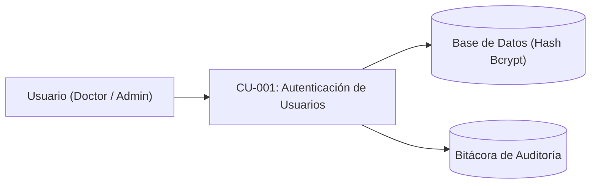

---

#### CU-002: Validación de Rol por Endpoint

| Campo | Descripción del Contenido |
| :--- | :--- |
| **ID** | CU-002 |
| **Nombre del Caso de Uso** | Validación de Rol por Endpoint |
| **Descripción** | Interceptar y validar el token JWT y el rol del usuario en cada petición HTTP hacia la API para autorizar o denegar la ejecución del controlador solicitado. |
| **Prioridad** | Alta |
| **Estado / Autor / Fecha** | Aprobado / Dr. Oscar Rueda / 29/09/2026 |
| **Requerimiento Asociado** | RF-02 |
| **Actores** | Servidor Backend (Sistema), Doctor, Administrador |
| **Reglas de Negocio** | - Las rutas clínicas y de expedientes de pacientes son exclusivas del rol Doctor. - Las rutas de gestión de usuarios y lectura de auditoría son exclusivas del rol Administrador. - Las peticiones sin token o con rol no autorizado deben ser rechazadas inmediatamente. |
| **Precondiciones** | Petición HTTP recibida en un endpoint protegido de la API REST. |
| **Entradas** | Encabezado HTTP `Authorization: Bearer <token>` y ruta de destino. |
| **Flujo Básico** | 1. El cliente envía una petición HTTP hacia un endpoint protegido. 2. El middleware de autenticación extrae el token del encabezado `Authorization`. 3. El sistema valida la firma criptográfica y la vigencia temporal del JWT. 4. El middleware de autorización extrae el rol contenido en el token y lo compara contra los permisos requeridos por el endpoint. 5. El sistema aprueba el acceso y transfiere la ejecución al controlador de negocio correspondiente. |
| **Flujo Alternativo** | 4a. Rutas de consulta general (ej. catálogo público): El sistema autoriza a los roles Doctor y Administrador simultáneamente. |
| **Excepciones** | 2a. Encabezado `Authorization` ausente o con formato incorrecto: El sistema responde con HTTP 401 Unauthorized. 3a. Token expirado o firma inválida: El sistema responde con HTTP 401 Unauthorized. 4b. Rol sin privilegios suficientes: El sistema responde con HTTP 403 Forbidden y detiene el procesamiento. |
| **Salidas** | Autorización concedida al controlador o respuesta HTTP con código de error 401 / 403. |
| **Postcondiciones** | La operación se ejecuta únicamente si el rol del solicitante cumple la política de seguridad RBAC. |
| **Criterios de Aceptación** | - Rechazo del 100% de peticiones sin token o con token alterado. - Bloqueo estricto del Administrador al intentar acceder a notas clínicas. - Bloqueo estricto del Doctor al intentar acceder a gestión de usuarios o bitácora de auditoría. |
| **Diagrama de Caso de Uso** | *Ver representación gráfica a continuación* |

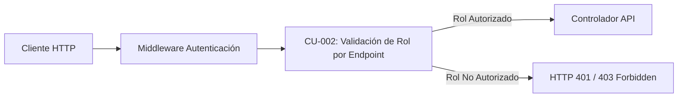

---

#### CU-003: Administración de Usuarios

| Campo | Descripción del Contenido |
| :--- | :--- |
| **ID** | CU-003 |
| **Nombre del Caso de Uso** | Administración de Usuarios |
| **Descripción** | Permitir al Administrador registrar nuevos usuarios en el sistema, conmutar su estado entre activo e inactivo, y actualizar sus contraseñas. |
| **Prioridad** | Media |
| **Estado / Autor / Fecha** | Aprobado / Dr. Oscar Rueda / 29/09/2026 |
| **Requerimiento Asociado** | RF-03 |
| **Actores** | Administrador |
| **Reglas de Negocio** | - El nombre de usuario (`username`) debe ser único en el sistema. - La contraseña debe contener un mínimo de 6 caracteres y ser almacenada como hash bcrypt. - El rol asignado debe pertenecer al catálogo predefinido (Doctor o Administrador). |
| **Precondiciones** | Sesión activa con rol Administrador. |
| **Entradas** | Nombre completo, identificador de usuario (`username`), contraseña (`password`), rol asignado y estado inicial. |
| **Flujo Básico** | 1. El Administrador ingresa al módulo de "Usuarios". 2. El sistema despliega el listado de usuarios con su rol y estado. 3. El Administrador pulsa "Crear Usuario" y completa el formulario. 4. El sistema valida los datos obligatorios y la unicidad del nombre de usuario. 5. El sistema calcula el hash bcrypt de la contraseña y persiste el registro en la base de datos. 6. El sistema inserta un registro del evento en la bitácora de auditoría. 7. El sistema actualiza la lista en pantalla y notifica el éxito de la operación. |
| **Flujo Alternativo** | 3a. Modificación de estado / contraseña: El Administrador selecciona un usuario existente, cambia su estado (activo/inactivo) o ingresa una nueva contraseña, y confirma los cambios. |
| **Excepciones** | 4a. Nombre de usuario ya existente: El sistema rechaza la solicitud indicando que el identificador está duplicado. 4b. Contraseña con longitud menor a 6 caracteres: El sistema impide el guardado y resalta el campo. |
| **Salidas** | Usuario registrado o actualizado en base de datos y mensaje de confirmación en pantalla. |
| **Postcondiciones** | El usuario queda disponible para autenticarse, o sus credenciales/estado se actualizan de inmediato. |
| **Criterios de Aceptación** | - Almacenamiento exclusivo del hash bcrypt en la base de datos. - Imposibilidad de crear identificadores duplicados. - Usuario desactivado pierde inmediatamente la capacidad de iniciar sesión. |
| **Diagrama de Caso de Uso** | *Ver representación gráfica a continuación* |

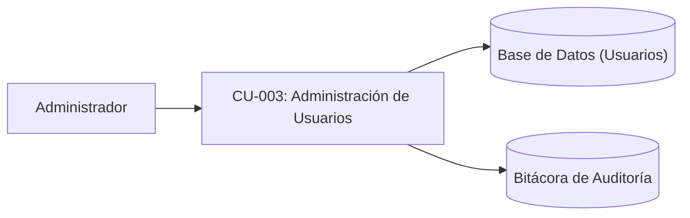

---

### Módulo 2: Padrón de Pacientes

#### CU-004: Registro de Datos Demográficos

| Campo | Descripción del Contenido |
| :--- | :--- |
| **ID** | CU-004 |
| **Nombre del Caso de Uso** | Registro de Datos Demográficos |
| **Descripción** | Capturar, validar y registrar en el sistema la información personal e identificatoria de un nuevo paciente. |
| **Prioridad** | Alta |
| **Estado / Autor / Fecha** | Aprobado / Dr. Oscar Rueda / 29/09/2026 |
| **Requerimiento Asociado** | RF-04 |
| **Actores** | Doctor, Administrador |
| **Reglas de Negocio** | - Campos obligatorios: tipo de documento, número de identificación, nombres, apellidos, fecha de nacimiento, sexo biológico y teléfono. - El número de identificación debe ser único para cada paciente. - La fecha de nacimiento no puede ser posterior a la fecha actual. |
| **Precondiciones** | Usuario autenticado en el sistema en la sección de pacientes. |
| **Entradas** | Tipo de documento, número de identificación, nombres, apellidos, fecha de nacimiento, sexo biológico, teléfono, correo electrónico (opcional), ocupación (opcional), dirección (opcional). |
| **Flujo Básico** | 1. El actor pulsa el botón "Nuevo Paciente". 2. El sistema despliega el formulario de captura demográfica. 3. El actor ingresa los datos y presiona "Guardar Paciente". 4. El sistema valida los campos obligatorios y el formato de la información. 5. El sistema comprueba que no exista otro paciente con el mismo número de documento. 6. El sistema almacena el registro en la base de datos relacional. 7. El sistema registra el evento en la bitácora de auditoría. 8. El sistema muestra mensaje de confirmación y actualiza el padrón de pacientes. |
| **Flujo Alternativo** | 3a. Edición de datos demográficos: El actor selecciona un paciente existente, actualiza los campos permitidos y guarda los cambios. |
| **Excepciones** | 4a. Campos obligatorios incompletos o fecha inválida: El sistema resalta los campos con error y cancela el guardado. 5a. Número de documento duplicado: El sistema notifica que el paciente ya está registrado y ofrece abrir su expediente. |
| **Salidas** | Registro de paciente persistido en base de datos y confirmación visual en pantalla. |
| **Postcondiciones** | El paciente queda disponible en el padrón para apertura de consultas e historial clínico. |
| **Criterios de Aceptación** | - Validación estricta de todos los campos obligatorios antes de enviar a base de datos. - Rechazo sistemático de números de documento duplicados. - Disponibilidad inmediata del paciente registrado para consultas clínicas. |
| **Diagrama de Caso de Uso** | *Ver representación gráfica a continuación* |

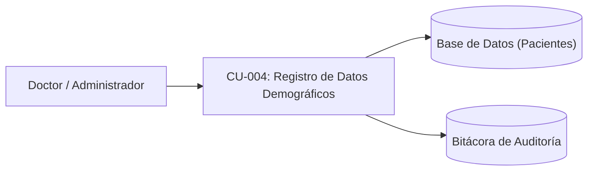

---

#### CU-005: Búsqueda de Pacientes por Criterio

| Campo | Descripción del Contenido |
| :--- | :--- |
| **ID** | CU-005 |
| **Nombre del Caso de Uso** | Búsqueda de Pacientes por Criterio |
| **Descripción** | Localizar expedientes de pacientes mediante filtrado predictivo por número de identificación, nombres o apellidos. |
| **Prioridad** | Alta |
| **Estado / Autor / Fecha** | Aprobado / Dr. Oscar Rueda / 29/09/2026 |
| **Requerimiento Asociado** | RF-05 |
| **Actores** | Doctor, Administrador |
| **Reglas de Negocio** | - La búsqueda debe coincidir con subcadenas sin distinguir entre mayúsculas y minúsculas. - La respuesta debe procesarse de manera asíncrona optimizada para consultas en tiempo real. |
| **Precondiciones** | Usuario autenticado en el sistema; existen registros de pacientes en la base de datos. |
| **Entradas** | Cadena de texto ingresada en la barra de búsqueda (cédula, nombres o apellidos). |
| **Flujo Básico** | 1. El actor ingresa texto en el campo de búsqueda del padrón. 2. El sistema envía la solicitud de búsqueda al servidor backend. 3. El sistema ejecuta la consulta SQL filtrando por coincidencia parcial en identificación, nombres o apellidos. 4. El sistema retorna los registros coincidentes. 5. El sistema renderiza la tabla de resultados mostrando identificación, nombre completo, edad, sexo y teléfono. |
| **Flujo Alternativo** | 1a. Si el campo de búsqueda queda vacío, el sistema despliega el listado completo de pacientes ordenado según criterio por defecto. |
| **Excepciones** | 4a. Cero coincidencias: El sistema muestra el mensaje "No se encontraron pacientes que coincidan con el criterio ingresado" y habilita el botón para crear un nuevo registro. |
| **Salidas** | Lista interactiva de pacientes filtrados según el término digitado. |
| **Postcondiciones** | El actor puede seleccionar un paciente específico para consultar su ficha o iniciar atención. |
| **Criterios de Aceptación** | - Retorno de resultados en menos de 300 ms en entorno de red local. - Búsqueda insensible a mayúsculas, minúsculas y tildes. |
| **Diagrama de Caso de Uso** | *Ver representación gráfica a continuación* |

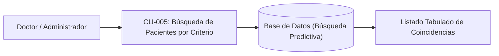

---

#### CU-006: Ficha Consolidada del Paciente

| Campo | Descripción del Contenido |
| :--- | :--- |
| **ID** | CU-006 |
| **Nombre del Caso de Uso** | Ficha Consolidada del Paciente |
| **Descripción** | Desplegar en una vista integral y centralizada la información demográfica, el registro de alergias y el compendio histórico de notas de consulta del paciente. |
| **Prioridad** | Alta |
| **Estado / Autor / Fecha** | Aprobado / Dr. Oscar Rueda / 29/09/2026 |
| **Requerimiento Asociado** | RF-06 |
| **Actores** | Doctor |
| **Reglas de Negocio** | - El expediente clínico y el historial de consultas solo pueden ser leídos por el rol Doctor. - Las notas de consulta deben presentarse ordenadas descendentemente por fecha (de la más reciente a la más antigua). - La apertura del expediente debe registrarse en la bitácora de auditoría. |
| **Precondiciones** | Paciente registrado en el sistema; sesión activa con rol Doctor. |
| **Entradas** | Identificador del paciente (`id_paciente`) seleccionado del padrón. |
| **Flujo Básico** | 1. El Doctor selecciona un paciente de la lista. 2. El sistema solicita al backend el expediente completo del paciente. 3. El sistema valida los permisos del rol Doctor. 4. El sistema consulta datos demográficos, alergias registradas y notas de consulta vinculadas. 5. El sistema registra el evento de lectura de expediente en la bitácora de auditoría. 6. El sistema renderiza la ficha consolidada: tarjeta demográfica, bloque de alergias, resumen de última visita y lista cronológica de notas. |
| **Flujo Alternativo** | 6a. Paciente nuevo sin consultas previas: El sistema despliega los datos demográficos y muestra el mensaje indicando que no registra notas clínicas previas, habilitando el botón "Iniciar Consulta". |
| **Excepciones** | 3a. Usuario con rol Administrador intenta acceder a la ficha clínica: El sistema responde con HTTP 403 Forbidden y redirige a la vista permitida. 4a. Identificador de paciente inexistente: El sistema responde con HTTP 404 Not Found y muestra un mensaje de error. |
| **Salidas** | Vista gráfica de la ficha consolidada del paciente con resumen clínico y acciones operativas. |
| **Postcondiciones** | Expediente visualizado y auditado; Doctor listo para registrar evolución o examinar antecedentes. |
| **Criterios de Aceptación** | - Despliegue prominente del estado de alergias (incluyendo condición NKDA). - Orden cronológico descendente riguroso de las consultas. - Registro obligatorio del evento en la bitácora de auditoría. |
| **Diagrama de Caso de Uso** | *Ver representación gráfica a continuación* |

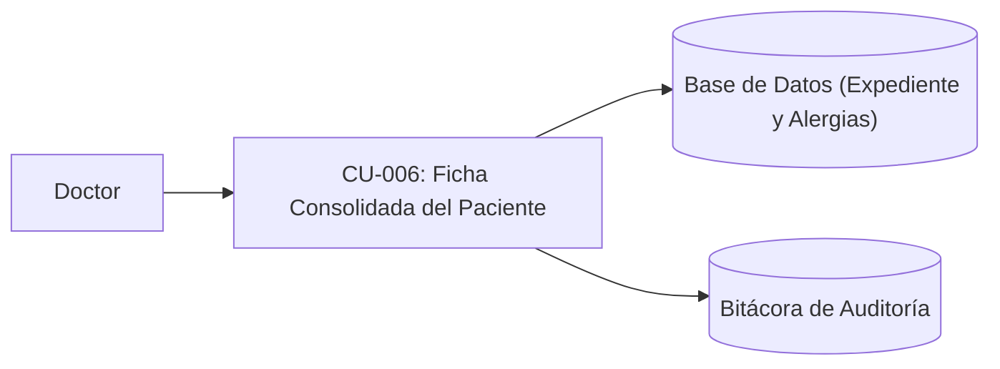

---

### Módulo 3: Historia Clínica Digital e Interconsulta

#### CU-007: Captura Estructurada de la Consulta

| Campo | Descripción del Contenido |
| :--- | :--- |
| **ID** | CU-007 |
| **Nombre del Caso de Uso** | Captura Estructurada de la Consulta |
| **Descripción** | Guiar al médico en el registro secuencial y estructurado de una consulta inicial o interconsulta a través de un asistente de 3 etapas (Historia, Examen Físico, Plan y Cierre). |
| **Prioridad** | Alta |
| **Estado / Autor / Fecha** | Aprobado / Dr. Oscar Rueda / 29/09/2026 |
| **Requerimiento Asociado** | RF-07 |
| **Actores** | Doctor |
| **Reglas de Negocio** | - La captura debe estructurarse en 3 etapas secuenciales obligatorias. - Las notas guardadas son inmutables; no se admiten modificaciones retroactivas ni eliminaciones físicas. - El IMC se calcula automáticamente mediante la fórmula: peso (kg) / [talla (m)]². - Se debe respaldar automáticamente el borrador en LocalStorage ante cada cambio para evitar pérdidas de datos. |
| **Precondiciones** | Doctor autenticado en el sistema; paciente seleccionado y ficha clínica activa. |
| **Entradas** | - *Etapa 1:* Tipo de atención (Visita Inicial / Interconsulta con médico solicitante), alergias (o NKDA), medicación activa con conciliación, motivo de consulta, HPI (8 dimensiones: localización, calidad, duración, temporalidad, severidad, contexto, factores modificadores, síntomas asociados), ROS (14 sistemas corporales) y antecedentes. - *Etapa 2:* Signos vitales (temperatura, pulso, presión arterial, frecuencia respiratoria, peso, talla) y casillas de exploración para 12 sistemas anatómicos más exploración genitourinaria. - *Etapa 3:* Estudios paraclínicos, lista de diagnósticos con código CIE-10, plan de manejo, médico evaluador, fecha y hora. |
| **Flujo Básico** | 1. El Doctor presiona "Iniciar Consulta" en la ficha del paciente. 2. El sistema despliega la Etapa 1 (Historia) y restaura borrador previo si existe en LocalStorage. 3. El Doctor diligencia motivo, HPI, ROS, alergias y antecedentes, y presiona "Siguiente: Examen Físico". 4. El sistema valida los datos de la Etapa 1 y pasa a la Etapa 2 (Examen Físico). 5. El Doctor ingresa los signos vitales; el sistema calcula y muestra instantáneamente el IMC; diligencia la exploración por sistemas y presiona "Siguiente: Plan y Cierre". 6. El sistema valida los datos de la Etapa 2 y muestra la Etapa 3. 7. El Doctor selecciona los códigos CIE-10, redacta la evaluación y plan de manejo, y presiona "Guardar y Finalizar Consulta". 8. El sistema valida la integridad de los datos, persiste la consulta en la base de datos y borra el borrador temporal de LocalStorage. 9. El sistema registra el evento en la bitácora de auditoría y actualiza la línea de tiempo del paciente. |
| **Flujo Alternativo** | 3a/5a. Navegación libre entre etapas: El Doctor puede retroceder a etapas previas para revisar o completar campos sin perder los datos ya ingresados. |
| **Excepciones** | 4a/6a/8a. Validación fallida (campos obligatorios vacíos, valores no numéricos en signos vitales, o ausencia de diagnóstico): El sistema resalta los campos faltantes e impide avanzar o finalizar. 8b. Falla de conexión con el backend: El sistema notifica el error de red, mantiene el borrador intacto en LocalStorage y permite reintentar el guardado. |
| **Salidas** | Registro clínico inmutable persistido en base de datos; consulta agregada a la línea de tiempo del paciente. |
| **Postcondiciones** | La consulta queda archivada con timestamp oficial UTC; no puede ser borrada ni sobrescrita. |
| **Criterios de Aceptación** | - Cálculo automático y exacto del IMC. - Persistencia completa de los 14 sistemas ROS y 8 dimensiones HPI. - Respaldo continuo en LocalStorage comprobado ante cierre accidental del navegador. |
| **Diagrama de Caso de Uso** | *Ver representación gráfica a continuación* |

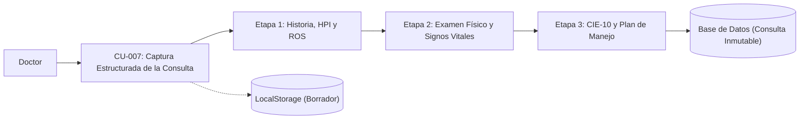

---

#### CU-008: Selección Asistida por Catálogo (Select2)

| Campo | Descripción del Contenido |
| :--- | :--- |
| **ID** | CU-008 |
| **Nombre del Caso de Uso** | Selección Asistida por Catálogo (Select2) |
| **Descripción** | Proporcionar componentes de búsqueda asistida con debounce para la selección ágil de términos predefinidos en alergias, medicamentos, antecedentes y diagnósticos CIE-10, permitiendo la creación de nuevos términos sobre la marcha. |
| **Prioridad** | Alta |
| **Estado / Autor / Fecha** | Aprobado / Dr. Oscar Rueda / 29/09/2026 |
| **Requerimiento Asociado** | RF-08 |
| **Actores** | Doctor |
| **Reglas de Negocio** | - La consulta al backend debe emitirse tras un retraso de inactividad (debounce) de 200 ms para optimizar el tráfico de red. - Si el término digitado por el médico no existe en el catálogo, debe permitirse agregarlo como una opción personalizada (etiquetado "Crear nuevo"). |
| **Precondiciones** | Formulario de consulta activo en la interfaz de usuario. |
| **Entradas** | Texto digitado por el médico en el campo selector de catálogo. |
| **Flujo Básico** | 1. El Doctor escribe los primeros caracteres en el campo de selección (ej. nombre de fármaco o código CIE-10). 2. El componente espera 200 ms desde la última pulsación de tecla. 3. El sistema realiza una petición HTTP al endpoint de catálogos (`/api/catalogos/:categoria?q=...`). 4. El sistema backend consulta la tabla correspondiente y devuelve las coincidencias. 5. El componente despliega un menú desplegable con las opciones encontradas. 6. El Doctor selecciona la opción deseada y el sistema la añade a la lista de selecciones activas. |
| **Flujo Alternativo** | 5a. Término no existente en el catálogo: El componente muestra la opción "Agregar: [término digitado]". El Doctor la selecciona, el sistema la asigna al campo y emite el guardado opcional en el catálogo. |
| **Excepciones** | 3a. Error de conexión con el catálogo backend: El componente permite al médico ingresar el valor como texto libre sin bloquear el diligenciamiento. |
| **Salidas** | Término clínico estandarizado o personalizado incorporado al formulario. |
| **Postcondiciones** | El dato queda estructurado para almacenamiento y posterior análisis estadístico. |
| **Criterios de Aceptación** | - Activación de la petición tras exactamente 200 ms de inactividad de teclado. - Respuesta visual del selector en menos de 300 ms en red local. - Admisión transparente de términos nuevos. |
| **Diagrama de Caso de Uso** | *Ver representación gráfica a continuación* |

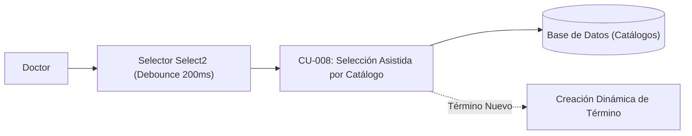

---

#### CU-009: Exportación Imprimible y Copia en Texto Plano

| Campo | Descripción del Contenido |
| :--- | :--- |
| **ID** | CU-009 |
| **Nombre del Caso de Uso** | Exportación Imprimible y Copia en Texto Plano |
| **Descripción** | Generar una representación de la consulta limpia y formateada para impresión física o copia directa en texto plano al portapapeles. |
| **Prioridad** | Media |
| **Estado / Autor / Fecha** | Aprobado / Dr. Oscar Rueda / 29/09/2026 |
| **Requerimiento Asociado** | RF-09 |
| **Actores** | Doctor |
| **Reglas de Negocio** | - La vista de impresión debe ocultar botones, barras de navegación y elementos de interfaz de usuario mediante reglas CSS `@media print`. - El texto plano copiado al portapapeles debe conservar un formato ordenado con saltos de línea claros y secciones identificables. |
| **Precondiciones** | Consulta médica registrada o en pantalla de resumen final. |
| **Entradas** | Clic sobre el botón "Imprimir Resumen" o "Copiar al Portapapeles". |
| **Flujo Básico** | 1. El Doctor visualiza el resumen de la consulta y presiona "Imprimir Resumen". 2. El sistema aplica las hojas de estilo `@media print`, formateando la consulta para hoja membretada estándar. 3. El sistema invoca el diálogo de impresión nativo del navegador (`window.print()`). 4. El Doctor selecciona la impresora o el destino PDF y confirma la impresión. |
| **Flujo Alternativo** | 1a. El Doctor presiona "Copiar al Portapapeles": El sistema procesa todos los campos de la consulta en una cadena estructurada en texto plano, la transfiere al portapapeles del sistema operativo y muestra una notificación temporal de confirmación. |
| **Excepciones** | 1b. Bloqueo de permisos de portapapeles en el navegador: El sistema despliega un área de texto modal con el texto seleccionado para que el médico lo copie manualmente con Ctrl+C. |
| **Salidas** | Documento físico/PDF formateado o texto plano copiado en el portapapeles del sistema. |
| **Postcondiciones** | Ninguna alteración sobre los datos en la base de datos. |
| **Criterios de Aceptación** | - La versión impresa no debe mostrar elementos de UI (botones, menús, barras de desplazamiento). - El contenido copiado en texto plano debe incluir encabezados claros de HPI, ROS, signos vitales, diagnósticos y plan. |
| **Diagrama de Caso de Uso** | *Ver representación gráfica a continuación* |

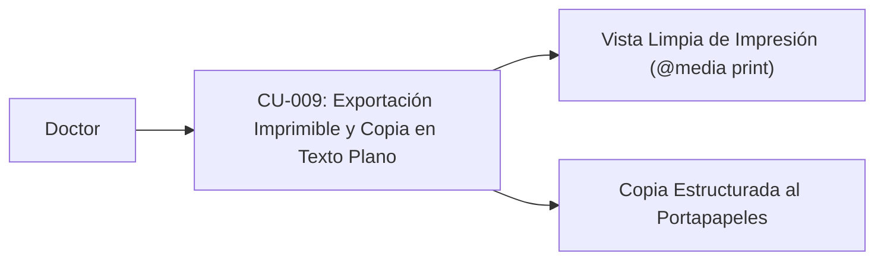

---

### Módulo 4: Seguimiento y Trazabilidad del Paciente

#### CU-010: Línea de Tiempo del Paciente

| Campo | Descripción del Contenido |
| :--- | :--- |
| **ID** | CU-010 |
| **Nombre del Caso de Uso** | Línea de Tiempo del Paciente |
| **Descripción** | Mostrar gráficamente el historial secuencial de consultas, evoluciones e interconsultas del paciente ordenadas cronológicamente para facilitar el seguimiento clínico. |
| **Prioridad** | Alta |
| **Estado / Autor / Fecha** | Aprobado / Dr. Oscar Rueda / 29/09/2026 |
| **Requerimiento Asociado** | RF-10 |
| **Actores** | Doctor |
| **Reglas de Negocio** | - Los eventos clínicos deben organizarse en orden cronológico estricto según su marca temporal ISO 8601. - Cada hito en la línea de tiempo debe indicar fecha, hora, tipo de atención (inicial o interconsulta), diagnóstico principal y profesional tratante. |
| **Precondiciones** | Paciente seleccionado en la aplicación; sesión activa con rol Doctor. |
| **Entradas** | Clic en la pestaña "Línea de Tiempo" dentro de la ficha del paciente. |
| **Flujo Básico** | 1. El Doctor selecciona la pestaña "Línea de Tiempo" en el expediente del paciente. 2. El sistema recupera el listado de todas las notas clínicas asociadas al paciente. 3. El sistema renderiza un componente visual de línea de tiempo con nodos secuenciales. 4. El Doctor visualiza los hitos y puede pulsar sobre cualquier nodo para desplegar el detalle completo de esa consulta. |
| **Flujo Alternativo** | 4a. Paciente sin historial previo: El sistema muestra un mensaje indicativo informando que no existen registros clínicos anteriores para este paciente. |
| **Excepciones** | 2a. Error de conexión con el backend: El sistema notifica que no fue posible cargar la línea de tiempo y ofrece un botón de reintento. |
| **Salidas** | Componente interactivo de línea de tiempo con tarjetas de eventos clínicos. |
| **Postcondiciones** | El Doctor dispone de la perspectiva histórica de la evolución del paciente. |
| **Criterios de Aceptación** | - Orden cronológico verificable por fecha y hora. - Despliegue de los detalles completos de una nota clínica al hacer clic en su tarjeta. |
| **Diagrama de Caso de Uso** | *Ver representación gráfica a continuación* |

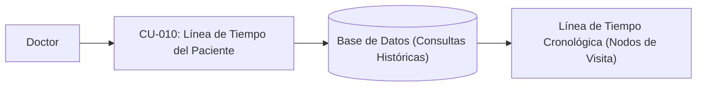

---

#### CU-011: Registro Histórico de Signos Vitales

| Campo | Descripción del Contenido |
| :--- | :--- |
| **ID** | CU-011 |
| **Nombre del Caso de Uso** | Registro Histórico de Signos Vitales |
| **Descripción** | Almacenar y presentar en una tabla comparativa cronológica los signos vitales tomados en cada visita del paciente para evaluar variaciones hemodinámicas en el tiempo. |
| **Prioridad** | Alta |
| **Estado / Autor / Fecha** | Aprobado / Dr. Oscar Rueda / 29/09/2026 |
| **Requerimiento Asociado** | RF-11 |
| **Actores** | Doctor |
| **Reglas de Negocio** | - Cada registro debe conservar: fecha, hora, temperatura (°C), pulso (lpm y regularidad), presión arterial (sistólica/diastólica y posición), frecuencia respiratoria (rpm), peso (kg), talla (m) e IMC calculado. - Los valores deben ser inmutables una vez registrada la consulta. |
| **Precondiciones** | Paciente con al menos una consulta registrada con signos vitales; rol Doctor autenticado. |
| **Entradas** | Clic en la sección "Signos Vitales" dentro del expediente del paciente. |
| **Flujo Básico** | 1. El Doctor accede a la sección de signos vitales dentro del expediente del paciente. 2. El sistema consulta todas las tomas de signos vitales registradas para el paciente. 3. El sistema tabula los datos por fecha y hora en orden cronológico. 4. El sistema resalta visualmente los valores que se encuentren fuera de los rangos fisiológicos estándar. 5. El Doctor compara la evolución de las variables a lo largo de las consultas. |
| **Flujo Alternativo** | 1a. El Doctor filtra el rango de fechas para examinar un periodo específico de visitas. |
| **Excepciones** | 2a. Paciente sin tomas previas: El sistema muestra el mensaje "No hay registros históricos de signos vitales disponibles". |
| **Salidas** | Tabla comparativa de signos vitales con cálculo automático de IMC para cada fecha. |
| **Postcondiciones** | El médico cuenta con evidencia cuantitativa del estado hemodinámico del paciente a lo largo del tiempo. |
| **Criterios de Aceptación** | - Despliegue correcto de todas las variables vitales sin omisiones. - Integridad histórica de los valores numéricos almacenados. |
| **Diagrama de Caso de Uso** | *Ver representación gráfica a continuación* |

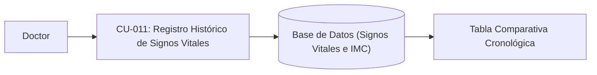

---

#### CU-012: Historial de Prescripciones Farmacológicas

| Campo | Descripción del Contenido |
| :--- | :--- |
| **ID** | CU-012 |
| **Nombre del Caso de Uso** | Historial de Prescripciones Farmacológicas |
| **Descripción** | Consolidar y listar los medicamentos prescritos o registrados a lo largo de las distintas consultas del paciente, facilitando la conciliación y el seguimiento farmacológico. |
| **Prioridad** | Media |
| **Estado / Autor / Fecha** | Aprobado / Dr. Oscar Rueda / 29/09/2026 |
| **Requerimiento Asociado** | RF-12 |
| **Actores** | Doctor |
| **Reglas de Negocio** | - Debe mostrar nombre del fármaco, dosis, frecuencia, vía de administración, estado del tratamiento (continuado, suspendido, modificado, nuevo) y fecha de indicación. |
| **Precondiciones** | Paciente con consultas previas que incluyan registros en la sección de medicación. |
| **Entradas** | Clic en la pestaña "Medicamentos" en la ficha del paciente. |
| **Flujo Básico** | 1. El Doctor ingresa a la pestaña de medicamentos del paciente. 2. El sistema recopila los registros de fármacos vinculados a las diferentes fechas de consulta. 3. El sistema genera una lista consolidada agrupada por medicamento y fecha de última actualización. 4. El Doctor revisa los fármacos activos e históricos para prevenir duplicidades o interacciones. |
| **Flujo Alternativo** | 4a. Durante una nueva consulta (Etapa 1), el sistema precarga automáticamente la medicación de la visita anterior para su conciliación rápida. |
| **Excepciones** | 2a. No existen prescripciones registradas: El sistema muestra el estado "Sin antecedentes farmacológicos registrados". |
| **Salidas** | Lista consolidada de medicamentos clasificados por estado y fecha de prescripción. |
| **Postcondiciones** | Visibilidad clara del tratamiento farmacológico previo para evitar interacciones medicamentosas. |
| **Criterios de Aceptación** | - Identificación precisa del estado de cada prescripción en cada consulta. - Precarga de la medicación activa en la consulta siguiente. |
| **Diagrama de Caso de Uso** | *Ver representación gráfica a continuación* |

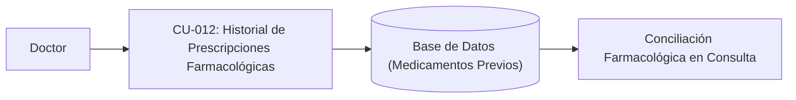

---

### Módulo 5: Análisis Clínico y Estadísticas

#### CU-013: Conteo y Frecuencia de Diagnósticos (CIE-10)

| Campo | Descripción del Contenido |
| :--- | :--- |
| **ID** | CU-013 |
| **Nombre del Caso de Uso** | Conteo y Frecuencia de Diagnósticos (CIE-10) |
| **Descripción** | Calcular y graficar la frecuencia de los códigos diagnósticos CIE-10 registrados en el consultorio, permitiendo acotar los resultados por intervalos de fechas. |
| **Prioridad** | Media |
| **Estado / Autor / Fecha** | Aprobado / Dr. Oscar Rueda / 29/09/2026 |
| **Requerimiento Asociado** | RF-13 |
| **Actores** | Doctor |
| **Reglas de Negocio** | - El cálculo debe procesar únicamente las consultas válidas registradas en el sistema. - El filtrado por fecha debe validar que la fecha inicial sea menor o igual a la fecha final. - La visualización debe ordenar los diagnósticos de mayor a menor frecuencia de aparición. |
| **Precondiciones** | Doctor autenticado en el sistema; existen consultas registradas con códigos CIE-10. |
| **Entradas** | Rango de fechas opcional (fecha de inicio y fecha de fin). |
| **Flujo Básico** | 1. El Doctor accede al módulo de "Reportes y Estadísticas". 2. El Doctor selecciona el rango de fechas deseado (o deja el valor por defecto: histórico total) y pulsa "Generar Reporte". 3. El sistema ejecuta una consulta de agregación (`COUNT`, `GROUP BY`) sobre los códigos CIE-10 asociados a las consultas en el intervalo dado. 4. El sistema retorna la lista de diagnósticos con su código, descripción y total de ocurrencias. 5. El sistema presenta los datos en una tabla ordenada y en un gráfico de barras interactivo. |
| **Flujo Alternativo** | 2a. El Doctor filtra por código específico o texto descriptivo para conocer la frecuencia puntual de una patología. |
| **Excepciones** | 2b. Fecha inicial posterior a fecha final: El sistema muestra alerta indicando la inconsistencia en el rango y cancela la consulta. 3a. Cero diagnósticos en el rango seleccionado: El sistema muestra el mensaje "No se registran diagnósticos en el periodo especificado". |
| **Salidas** | Tabla estadística y gráfica de frecuencias de diagnósticos CIE-10. |
| **Postcondiciones** | El Doctor obtiene información epidemiológica consolidada para la toma de decisiones clínicas y de gestión. |
| **Criterios de Aceptación** | - Conteo exacto verificado contra los registros individuales de la base de datos. - Tiempo de generación del reporte menor a 1.0 segundo para volúmenes estándar de consultorio. |
| **Diagrama de Caso de Uso** | *Ver representación gráfica a continuación* |

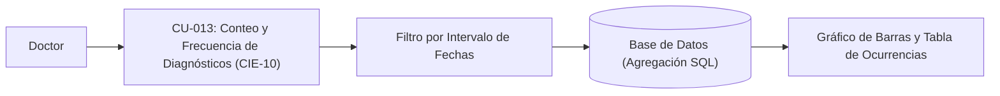

---

#### CU-014: Consulta de Casos por Diagnóstico Compartido

| Campo | Descripción del Contenido |
| :--- | :--- |
| **ID** | CU-014 |
| **Nombre del Caso de Uso** | Consulta de Casos por Diagnóstico Compartido |
| **Descripción** | Permitir al médico seleccionar un código CIE-10 específico y listar los planes de manejo, conductas y evoluciones terapéuticas documentadas en otros pacientes con la misma patología. |
| **Prioridad** | Media |
| **Estado / Autor / Fecha** | Aprobado / Dr. Oscar Rueda / 29/09/2026 |
| **Requerimiento Asociado** | RF-14 |
| **Actores** | Doctor |
| **Reglas de Negocio** | - La visualización de casos compartidos debe mantener la confidencialidad clínica y estar restringida exclusivamente al profesional médico autorizado. - Los resultados deben presentar el diagnóstico, el plan de manejo prescrito, la fecha y la evolución observada. |
| **Precondiciones** | Doctor autenticado; existen pacientes con consultas asociadas a dicho código CIE-10. |
| **Entradas** | Código o nombre de patología CIE-10 seleccionado. |
| **Flujo Básico** | 1. El Doctor ingresa a la vista de análisis clínico o selecciona un diagnóstico en el reporte de frecuencias. 2. El Doctor solicita "Ver Casos con este Diagnóstico". 3. El sistema busca todas las consultas médicas que contienen dicho código CIE-10. 4. El sistema agrupa y despliega las notas de evolución, tratamientos instaurados y resultados clínicos asociados a ese diagnóstico. 5. El Doctor analiza los esquemas terapéuticos previos y sus desenlaces para orientar su conducta médica en el caso actual. |
| **Flujo Alternativo** | 1a. El Doctor realiza la consulta cruzada directamente desde el selector de diagnóstico de una consulta en curso. |
| **Excepciones** | 3a. No se registran otros pacientes con ese código: El sistema informa que es la primera vez que se documenta dicha patología en el consultorio. |
| **Salidas** | Panel comparativo de conductas terapéuticas y respuestas clínicas para el diagnóstico seleccionado. |
| **Postcondiciones** | El médico cuenta con evidencia empírica interna del consultorio para apoyar su toma de decisiones. |
| **Criterios de Aceptación** | - Filtrado fidedigno por código CIE-10. - Enlace directo a los planes de manejo documentados. |
| **Diagrama de Caso de Uso** | *Ver representación gráfica a continuación* |

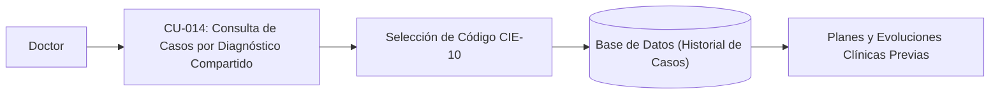

---

### Módulo 6: Auditoría y Catálogos (Administrador)

#### CU-015: Registro de Auditoría de Acciones

| Campo | Descripción del Contenido |
| :--- | :--- |
| **ID** | CU-015 |
| **Nombre del Caso de Uso** | Registro de Auditoría de Acciones |
| **Descripción** | Registrar de forma automática, inmutable y persistente cada acción sensible de lectura, creación o modificación ejecutada en el sistema, y permitir su consulta al Administrador. |
| **Prioridad** | Alta |
| **Estado / Autor / Fecha** | Aprobado / Dr. Oscar Rueda / 29/09/2026 |
| **Requerimiento Asociado** | RF-15 |
| **Actores** | Sistema (Automático), Administrador |
| **Reglas de Negocio** | - La bitácora debe ser estrictamente inmutable (prohibidas las operaciones `UPDATE` y `DELETE` en la tabla y en la API). - Cada registro debe capturar: `id_usuario`, `rol`, `tipo_accion`, `recurso_afectado`, `direccion_ip` y `timestamp` en UTC. - La consulta de la bitácora es privilegio exclusivo del rol Administrador. |
| **Precondiciones** | El sistema se encuentra en funcionamiento procesando peticiones. |
| **Entradas** | Evento originado por una petición HTTP (login, consulta de expediente, guardado de historia, modificación de usuario o catálogo). |
| **Flujo Básico** | 1. Un actor ejecuta una acción en el sistema (ej. inicio de sesión o lectura de expediente). 2. El middleware o servicio intercepta la acción y recopila los datos contextuales (usuario, rol, IP, ruta, acción, fecha y hora). 3. El sistema inserta un nuevo registro en la tabla de auditoría de la base de datos de manera atómica. 4. El Administrador accede al módulo "Bitácora de Auditoría". 5. El sistema valida el rol de Administrador y despliega los eventos en una tabla ordenada descendentemente por fecha. |
| **Flujo Alternativo** | 4a. El Administrador aplica filtros por usuario, fecha o tipo de acción para investigar un evento específico. |
| **Excepciones** | 3a. Error en la inserción de auditoría: El sistema genera una alerta en los logs de consola del servidor y rechaza la transacción para no permitir operaciones sin auditar. 4b. Rol Doctor intenta acceder a la bitácora: El sistema bloquea el acceso con código HTTP 403 Forbidden. |
| **Salidas** | Registro inmutable en base de datos; vista de monitoreo de auditoría para el Administrador. |
| **Postcondiciones** | Queda trazabilidad forense indeleble de cada interacción con los datos del consultorio. |
| **Criterios de Aceptación** | - Imposibilidad técnica de alterar o borrar registros de la tabla de auditoría. - Registro inmediato y automático en el 100% de las acciones auditables especificadas. |
| **Diagrama de Caso de Uso** | *Ver representación gráfica a continuación* |

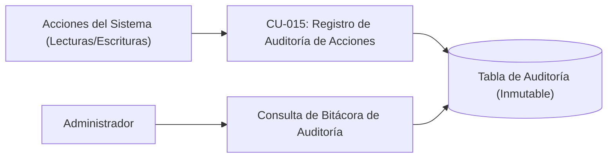

---

#### CU-016: Gestión de Catálogos Médicos

| Campo | Descripción del Contenido |
| :--- | :--- |
| **ID** | CU-016 |
| **Nombre del Caso de Uso** | Gestión de Catálogos Médicos |
| **Descripción** | Administrar y mantener los ítems predefinidos de los catálogos del sistema (alergias, medicamentos, antecedentes patológicos, diagnósticos CIE-10 y motivos de consulta). |
| **Prioridad** | Media |
| **Estado / Autor / Fecha** | Aprobado / Dr. Oscar Rueda / 29/09/2026 |
| **Requerimiento Asociado** | RF-16 |
| **Actores** | Administrador, Doctor (adición en consulta) |
| **Reglas de Negocio** | - Cada ítem del catálogo debe pertenecer a una categoría válida y contar con un término no vacío. - Se debe evitar la duplicidad exacta de términos dentro de la misma categoría. - El Administrador puede gestionar directamente todos los catálogos; el Doctor puede añadir términos nuevos durante la captura clínica. |
| **Precondiciones** | Usuario autenticado con rol Administrador (para gestión global) o Doctor (durante consulta). |
| **Entradas** | Categoría del catálogo, código (opcional) y término/nombre clínico. |
| **Flujo Básico** | 1. El Administrador accede a la sección "Mantenimiento de Catálogos". 2. El sistema despliega el catálogo seleccionado (ej. CIE-10, Medicamentos o Alergias). 3. El Administrador pulsa "Agregar Ítem", digita el código y término, y confirma la acción. 4. El sistema valida que el término no se encuentre duplicado en dicha categoría. 5. El sistema almacena el nuevo ítem en la base de datos relacional. 6. El sistema registra la acción en la bitácora de auditoría y actualiza la lista. |
| **Flujo Alternativo** | 3a. Modificación de un término existente por parte del Administrador para corregir ortografía o descripción. 3b. Creación dinámica por el Doctor: Durante el diligenciamiento de una consulta, el Doctor digita un término no existente y confirma su inclusión. |
| **Excepciones** | 4a. Término ya existente en la categoría: El sistema informa que el elemento ya se encuentra registrado y cancela la duplicación. |
| **Salidas** | Catálogo actualizado disponible inmediatamente para búsquedas predictivas en todo el sistema. |
| **Postcondiciones** | Los nuevos términos quedan indexados para futuras consultas de autocompletado. |
| **Criterios de Aceptación** | - Disponibilidad instantánea del nuevo término para el componente Select2 sin necesidad de reiniciar el servidor. - Prevención de duplicados exactos en la misma categoría. |
| **Diagrama de Caso de Uso** | *Ver representación gráfica a continuación* |

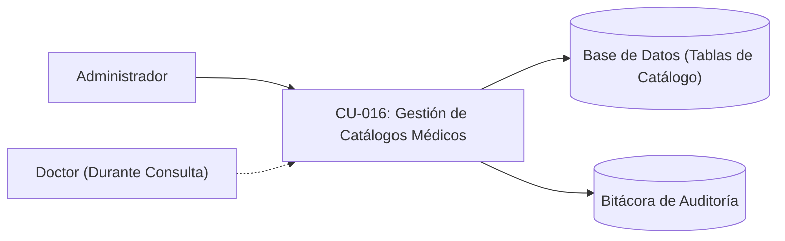

---

## 4. Requerimientos No Funcionales (RNF)

Esta tabla permite capturar las restricciones, estándares y atributos de calidad que el sistema debe cumplir, independientemente de los casos de uso específicos.

| ID | Categoría | Nombre del Requerimiento | Descripción | Métrica / Criterio de Evaluación | Prioridad | Requerimientos Asociados |
| :--- | :--- | :--- | :--- | :--- | :--- | :--- |
| **RNF-001** | Seguridad | Cifrado y Hash de Contraseñas | El sistema debe almacenar todas las contraseñas de las cuentas de usuario procesadas mediante la función de dispersión unidireccional bcrypt, impidiendo el almacenamiento o transmisión en texto claro bajo cualquier circunstancia. | Factor de trabajo (salt rounds) no menor a 10 en todas las operaciones de hash; 0% de contraseñas almacenadas en texto plano en la base de datos. | Alta | CU-001 (RF-01), CU-003 (RF-03) |
| **RNF-002** | Seguridad | Firma Digital y Caducidad de Tokens JWT | La autenticación de sesiones debe gestionarse mediante tokens JWT firmados digitalmente por el backend mediante el algoritmo HMAC-SHA256, con una ventana de caducidad estricta para mitigar el secuestro de sesión. | Algoritmo HMAC-SHA256 verificado en cada petición; tiempo de expiración del token exactamente menor o igual a 8 horas desde su emisión; revocación o rechazo del 100% de tokens vencidos. | Alta | CU-001 (RF-01), CU-002 (RF-02) |
| **RNF-003** | Rendimiento | Tiempo de Respuesta en Búsquedas Predictivas | Las peticiones de búsqueda de pacientes y de términos en los catálogos médicos (Select2) deben ejecutarse y responder al cliente en un tiempo imperceptible para mantener la agilidad del profesional durante la consulta. | Latencia de respuesta en backend menor o igual a 300 ms en red local para catálogos de hasta 10.000 registros, con debounce en frontend de 200 ms. | Alta | CU-005 (RF-05), CU-008 (RF-08) |
| **RNF-004** | Rendimiento | Tiempo de Carga Inicial de la Aplicación | El paquete de recursos iniciales (HTML, JavaScript compilado y CSS) de la interfaz de usuario servido vía HTTP debe descargarse y presentar el primer contenido interactivo de manera rápida en el navegador. | First Contentful Paint (FCP) y tiempo de carga total del paquete inicial menor a 2.0 segundos bajo red de área local (LAN/Wi-Fi del consultorio). | Media | CU-001 al CU-016 (Todos los casos de uso) |
| **RNF-005** | Integridad / Confiabilidad | Estandarización e Integridad Temporal | Todas las fechas y marcas de tiempo capturadas para consultas, signos vitales y eventos de auditoría deben almacenarse de forma unificada para garantizar la trazabilidad cronológica fidedigna y evitar discrepancias de zona horaria. | 100% de las marcas de tiempo almacenadas como tipo `TIMESTAMP WITH TIME ZONE` en formato ISO 8601 (UTC). | Alta | CU-007 (RF-07), CU-010 (RF-10), CU-011 (RF-11), CU-015 (RF-15) |
| **RNF-006** | Usabilidad / Resiliencia | Retención Local del Estado de Captura (LocalStorage) | La aplicación cliente debe proteger al médico contra pérdidas accidentales de información por cierre de ventana, recarga fortuita o corte de energía, persistiendo en tiempo real el borrador de la historia clínica en el navegador. | Sincronización automática en `localStorage` en menos de 100 ms tras cada cambio de campo; restauración automática del 100% de los datos al recargar la página antes del guardado final. | Alta | CU-007 (RF-07), CU-008 (RF-08) |
| **RNF-007** | Seguridad / Auditoría | Inmutabilidad Absoluta de la Bitácora de Auditoría | Los registros de la tabla de auditoría deben ser inalterables y no eliminables una vez escritos, preservando la validez legal y forense de las trazas del sistema. | 0 rutas HTTP y 0 procedimientos en base de datos que ejecuten sentencias `UPDATE` o `DELETE` sobre la tabla de auditoría; denegación total a nivel de esquema o middleware. | Alta | CU-015 (RF-15) |
| **RNF-008** | Portabilidad / Compatibilidad | Compatibilidad Multi-Navegador | La interfaz web debe operar sin distorsiones estéticas, excepciones de JavaScript ni bloqueos funcionales en los principales navegadores web utilizados en entornos médicos y administrativos. | 0 errores de consola y funcionalidad al 100% en las 2 versiones estables más recientes de Google Chrome, Mozilla Firefox y Microsoft Edge. | Media | CU-001 al CU-016 (Todos los casos de uso) |
| **RNF-009** | Disponibilidad / Resiliencia | Tolerancia a Fallos de Conexión a Base de Datos | Si la base de datos PostgreSQL no se encuentra disponible al inicializar el servidor backend, el sistema no debe abortar su proceso, sino degradar su almacenamiento a un repositorio en memoria local notificando el evento para permitir pruebas y continuidad de contingencia. | Disponibilidad de servicio HTTP del 100% ante ausencia del puerto PostgreSQL al arranque, activando almacenamiento temporal en memoria y registrando log de contingencia en consola. | Media | CU-001 al CU-016 (Todos los casos de uso) |

---

## 5. Matriz de Roles y Permisos (RBAC)

| Operación del Sistema | Caso de Uso Asociado | Administrador | Doctor |
| :--- | :--- | :---: | :---: |
| Autenticación con usuario y contraseña | **CU-001** (RF-01) | Habilitado | Habilitado |
| Validación y control de acceso por endpoint | **CU-002** (RF-02) | Habilitado | Habilitado |
| Crear y modificar cuentas de usuario | **CU-003** (RF-03) | Habilitado | Inhabilitado |
| Registrar y modificar datos demográficos de pacientes | **CU-004** (RF-04) | Habilitado | Habilitado |
| Búsqueda de pacientes por criterio | **CU-005** (RF-05) | Habilitado | Habilitado |
| Consultar ficha consolidada del paciente | **CU-006** (RF-06) | Inhabilitado | Habilitado |
| Registrar consulta o interconsulta médica estructurada | **CU-007** (RF-07) | Inhabilitado | Habilitado |
| Selección asistida por catálogos (Select2) | **CU-008** (RF-08) | Inhabilitado | Habilitado |
| Exportación imprimible y copia en texto plano | **CU-009** (RF-09) | Inhabilitado | Habilitado |
| Visualizar línea de tiempo del paciente | **CU-010** (RF-10) | Inhabilitado | Habilitado |
| Consultar registro histórico de signos vitales | **CU-011** (RF-11) | Inhabilitado | Habilitado |
| Consultar historial de prescripciones farmacológicas | **CU-012** (RF-12) | Inhabilitado | Habilitado |
| Consultar reporte estadístico de diagnósticos (CIE-10) | **CU-013** (RF-13) | Inhabilitado | Habilitado |
| Filtrar casos clínicos por diagnóstico compartido | **CU-014** (RF-14) | Inhabilitado | Habilitado |
| Consultar bitácora de auditoría | **CU-015** (RF-15) | Habilitado | Inhabilitado |
| Gestión y mantenimiento de catálogos médicos | **CU-016** (RF-16) | Habilitado | Habilitado (durante la captura) |

---

## 6. Matriz de Cobertura: Requerimientos vs Situación del Consultorio

| Factor de la Situación en Papel | Limitación Operativa | Caso de Uso y Requerimiento de Solución | Criterio de Verificación |
| :--- | :--- | :--- | :--- |
| **Almacenamiento en papel** | Tiempo requerido para ubicar físicamente una carpeta archivada. | **CU-004 (RF-04), CU-005 (RF-05), CU-006 (RF-06)** | Búsqueda por documento o nombre con respuesta menor a 300 ms en red local. |
| **Pérdida de trazabilidad** | Dificultad para ordenar cronológicamente las hojas de diferentes fechas. | **CU-007 (RF-07), CU-010 (RF-10), CU-011 (RF-11), RNF-005** | Lista cronológica ordenada por timestamp ISO 8601 sin opción de borrado. |
| **Vulnerabilidad de acceso a los datos** | El expediente físico puede ser leído por personas no autorizadas sin dejar rastro. | **CU-001 (RF-01), CU-002 (RF-02), CU-015 (RF-15), RNF-001, RNF-007** | Validación de JWT por endpoint y registro de cada lectura en tabla inmutable de auditoría. |
| **Falta de consolidación de información** | Imposibilidad de tabular manualmente diagnósticos frecuentes o tratamientos en papel. | **CU-013 (RF-13), CU-014 (RF-14)** | Cálculo automatizado de frecuencias de códigos CIE-10 y filtro por diagnóstico compartido. |
| **Tiempo de digitación en consulta** | Redacción manual repetitiva de exploraciones y recetas completas. | **CU-008 (RF-08), RNF-006** | Selección con autocompletado en catálogos y respaldo de borrador en LocalStorage. |
