# Especificación de Requerimientos de Software (SRS)

**Proyecto:** Aplicación Web para la Digitalización, Gestión Segura y Análisis Estructurado de Historias Clínicas  
**Entorno de Aplicación:** Consultorio Médico del Dr. Oscar Rueda  
**Autor:** Raúl Santiago Hallado Abaunza  
**Director:** Mgtr. Lenin Javier Serrano Gil  
**Institución:** Universidad Pontificia Bolivariana - Escuela de Ingenierías - Ingeniería de Sistemas e Informática (Bucaramanga, 2026)  
**Estándar de Referencia:** IEEE Std 830 / ISO/IEC/IEEE 29148  

---

## 1. Introducción

### 1.1 Propósito
El propósito de este documento es especificar los requerimientos funcionales, las historias de usuario, los casos de uso y los requerimientos no funcionales para la aplicación web de digitalización, gestión segura y análisis estructurado de historias clínicas del Consultorio Médico del Dr. Oscar Rueda. Los requerimientos aquí descritos definen condiciones verificables y medibles tanto para la evaluación del prototipo funcional en la nube como para la proyección de su arquitectura de producción en Google Cloud.

### 1.2 Alcance del Sistema
El sistema comprende una aplicación web alojada en la nube orientada a:
- Registrar datos demográficos de pacientes, su consentimiento previo, expreso e informado (con finalidad clínica y analítica bajo la Ley 1581 de 2012) y notas clínicas estructuradas (visita hospitalaria inicial e interconsulta).
- Implementar control de acceso basado en roles (RBAC), protección contra accesos directos no autorizados (*bypass*) y bitácora de auditoría inalterable en cumplimiento de la Resolución 1995 de 1999 y la Ley 2015 de 2020.
- Integrar el respaldo y gestión documental de las historias clínicas mediante la API de Google Drive en la fase de prototipo, proyectando su almacenamiento definitivo en Google Cloud.
- Desplegar una línea de tiempo cronológica de las atenciones, signos vitales y prescripciones farmacológicas de cada paciente.
- Consolidar reportes estadísticos y analíticos de diagnósticos codificados en CIE-10 y evaluar la evolución de tratamientos históricos para apoyar la toma de decisiones médicas basadas en evidencia.

### 1.3 Definiciones, Siglas y Acrónimos
- **HCE (Historia Clínica Electrónica):** Registro digital e integral que almacena de forma cronológica los datos demográficos, antecedentes, diagnósticos y tratamientos de un paciente.
- **HCEI (Historia Clínica Electrónica Interoperable):** Marco regulatorio establecido por la Ley 2015 de 2020 en Colombia para garantizar disponibilidad, integridad y confidencialidad clínica.
- **HPI (History of Present Illness):** Relato de la enfermedad actual desglosado en 8 dimensiones semiológicas específicas.
- **ROS (Review of Systems):** Revisión por sistemas corporales estructurada en 14 aparatos.
- **CIE-10:** Clasificación Internacional de Enfermedades, décima edición.
- **IMC:** Índice de Masa Corporal, calculado mediante la fórmula: peso (kg) / [talla (m)]².
- **RBAC (Role-Based Access Control):** Control de acceso basado en roles exigido por el Decreto Único Reglamentario 1074 de 2015.
- **RNBD (Registro Nacional de Bases de Datos):** Directorio público administrado por la Superintendencia de Industria y Comercio (SIC) donde se inscriben las políticas de tratamiento de datos.
- **JWT (JSON Web Token):** Estándar de transmisión de afirmaciones de identidad (RFC 7519) firmado digitalmente mediante HMAC-SHA256.
- **Cold Start (Arranque en Frío):** Latencia inicial producida en servicios de cómputo en la nube de capa gratuita (como Render) cuando la instancia entra en reposo por inactividad.
- **Bypass de Acceso Directo:** Vulnerabilidad en la que un recurso o documento en la nube es accedido directamente omitiendo la validación del servidor backend.
- **Bitácora de Auditoría:** Tabla inalterable de registros que almacena usuario, rol, fecha, hora en UTC, dirección IP y acción ejecutada (Resolución 1995 de 1999).

### 1.4 Contexto y Pregunta Problema
- **Situación Base:** El consultorio del Dr. Oscar Rueda opera tradicionalmente con historias clínicas físicas en formato de papel, lo cual demora la búsqueda y obtención de antecedentes históricos, dificulta mantener una trazabilidad rigurosa del expediente, expone los documentos a deterioro o accesos no autorizados y limita la capacidad del especialista para identificar tendencias en diagnósticos o evaluar cuantitativamente la evolución de tratamientos.
- **Pregunta Problema:** *¿De qué manera el desarrollo de un sistema de digitalización y análisis de historias clínicas permite apoyar el proceso de seguimiento de los pacientes, garantizando la trazabilidad de los datos y facilitando la toma de decisiones médicas en el consultorio del Dr. Oscar Rueda?*

---

## 2. Descripción General

### 2.1 Perspectiva del Producto y Arquitectura en la Nube
El ciclo de vida del software se desarrolla bajo una metodología híbrida de **Prototipos y Kanban** (optimizada para limitar el trabajo en progreso de un único desarrollador), estructurando la arquitectura tecnológica en dos fases de despliegue en la nube:

1. **Arquitectura del Prototipo Funcional:**
   - **Frontend (Vercel):** Aplicación web (Single Page Application) construida en React y TypeScript con comunicación asíncrona HTTPS/JSON hacia la API y persistencia preventiva de borradores en `LocalStorage`.
   - **Backend (Render):** Servicio API REST implementado en Node.js con Express y TypeScript bajo arquitectura en capas (Controladores, Servicios, Repositorios), validación JWT/RBAC y manejo de contingencia en memoria.
   - **Base de Datos Relacional (PostgreSQL):** Almacenamiento estructurado con integridad referencial para usuarios, pacientes, consentimientos, historias clínicas, catálogos CIE-10 y bitácora de auditoría.
   - **Almacenamiento Documental (API de Google Drive):** Integración con la API de Google Drive para la generación y resguardo de soportes documentales de las historias clínicas durante la evaluación del prototipo con datos médicos simulados.
2. **Proyección de Arquitectura de Producción (Google Cloud):**
   - A partir de las pruebas del prototipo (orientadas a evaluar y mitigar la latencia por tiempos de arranque en frío o *cold starts* en Render y las vulnerabilidades de acceso directo o *bypass* sobre archivos externos), se proyecta la migración integral del frontend, backend, base de datos gestionada (Cloud SQL para PostgreSQL) y repositorio documental privado (Cloud Storage con IAM y URLs firmadas) hacia **Google Cloud**, garantizando disponibilidad continua, confidencialidad e integridad normativa.

### 2.2 Roles de Usuario y Responsabilidades Legales
Conforme al Decreto Único Reglamentario 1074 de 2015, el consultorio médico actúa como **Responsable del Tratamiento** y el administrador/desarrollador de la plataforma como **Encargado del Tratamiento**. El sistema define dos perfiles operativos con permisos mutuamente excluyentes en áreas clínicas sensibles:

| Rol | Descripción | Permisos Asignados |
| :--- | :--- | :--- |
| **Administrador** | Encargado del mantenimiento técnico, seguridad y cumplimiento normativo del sistema. | Gestión de usuarios (creación, activación, desactivación), edición de catálogos médicos, lectura de bitácora de auditoría (Resolución 1995 de 1999) y consulta de métricas consolidadas de consentimientos e inventario para el RNBD (SIC). No posee permisos de lectura ni escritura sobre las notas clínicas de los pacientes. |
| **Doctor** | Profesional asistencial de la salud (Dr. Oscar Rueda). | Registro y consulta de datos demográficos de pacientes, captura de consentimiento informado (Ley 1581 de 2012), registro y consulta de historias clínicas, exportación y respaldo en Google Drive / Cloud, visualización de la línea de tiempo del paciente y consulta de reportes estadísticos de diagnósticos CIE-10 y evolución de tratamientos. |

### 2.3 Marco Normativo y Restricciones Generales
- **Protección de Datos Sensibles (Artículo 15 Constitución Política, Ley 1581 de 2012 y Decreto 1074 de 2015):** Ningún expediente clínico puede ser procesado ni incluido en analíticas sin haber registrado previamente el consentimiento explícito, previo e informado del titular especificando su finalidad asistencial y analítica.
- **Inmutabilidad Clínica y Auditoría (Resolución 1995 de 1999 y Ley 2015 de 2020):** Las notas clínicas guardadas y los registros de la bitácora de auditoría no podrán ser modificados ni eliminados de la base de datos; cualquier aclaración clínica posterior debe registrarse como una nueva nota de evolución con marca temporal independiente.
- **Seguridad en la Nube:** Toda petición enviada al servidor backend que involucre datos de pacientes o documentos en la nube debe contener un encabezado HTTP `Authorization` con un token JWT válido, impidiendo el acceso directo (*bypass*) a los recursos almacenados.

---

## 3. Catálogo de Requerimientos Funcionales e Historias de Usuario

En cumplimiento del primer objetivo específico del proyecto y la gestión del flujo de trabajo bajo el marco **Kanban**, a continuación se presenta la tabla maestra que relaciona cada Requerimiento Funcional (`RF-01` a `RF-18`) con su respectiva Historia de Usuario (`HU-01` a `HU-18`) y Caso de Uso detallado (`CU-001` a `CU-018`):

| ID RF | ID HU | ID CU | Módulo | Enunciado de la Historia de Usuario (Como... Quiero... Para...) | Prioridad | Criterio Principal de Aceptación |
| :--- | :--- | :--- | :--- | :--- | :--- | :--- |
| **RF-01** | **HU-01** | **CU-001** | Módulo 1: Autenticación y Control de Acceso | **Como** usuario registrado (Doctor o Administrador), **quiero** iniciar sesión con mis credenciales verificadas contra un hash criptográfico, **para** obtener un token JWT que respalde de forma segura mi sesión en la nube. | Alta | Validación bcrypt (salt >= 10), emisión de JWT HMAC-SHA256 (vigencia <= 8h) y registro en bitácora. |
| **RF-02** | **HU-02** | **CU-002** | Módulo 1: Autenticación y Control de Acceso | **Como** responsable de seguridad del sistema, **quiero** que cada endpoint valide el token JWT y el rol del usuario bloqueando peticiones directas no autorizadas, **para** impedir vulnerabilidades de *bypass* y proteger la confidencialidad clínica. | Alta | Rechazo del 100% de accesos sin JWT válido o con rol distinto al autorizado (HTTP 401/403). |
| **RF-03** | **HU-03** | **CU-003** | Módulo 1: Autenticación y Control de Acceso | **Como** Administrador, **quiero** crear cuentas de usuario, actualizar sus contraseñas y activar o desactivar su acceso, **para** mantener el control de identidades bajo el esquema RBAC. | Media | Unicidad de `username`, almacenamiento exclusivo en hash bcrypt y bloqueo inmediato de cuentas inactivas. |
| **RF-04** | **HU-04** | **CU-004** | Módulo 2: Gestión de Pacientes y Cumplimiento de Habeas Data | **Como** Doctor o Administrador, **quiero** registrar y actualizar los datos demográficos e identificatorios de cada paciente, **para** digitalizar el directorio del consultorio sin duplicidad de expedientes. | Alta | Validación de campos obligatorios, documento único y registro sólo habilitado con consentimiento activo. |
| **RF-05** | **HU-05** | **CU-005** | Módulo 2: Gestión de Pacientes y Cumplimiento de Habeas Data | **Como** Doctor, **quiero** buscar pacientes de forma predictiva por número de documento, nombres o apellidos, **para** localizar inmediatamente su expediente sin revisar carpetas físicas en papel. | Alta | Filtrado insensible a mayúsculas/tildes con latencia de API <= 300 ms en instancia activa. |
| **RF-06** | **HU-06** | **CU-006** | Módulo 2: Gestión de Pacientes y Cumplimiento de Habeas Data | **Como** Doctor, **quiero** visualizar en una ficha consolidada los datos demográficos, alergias y resumen de consultas del paciente, **para** conocer su contexto clínico integral al iniciar la atención. | Alta | Acceso exclusivo para rol Doctor, alergias destacadas y registro automático de lectura en auditoría. |
| **RF-07** | **HU-07** | **CU-007** | Módulo 3: Historia Clínica Digital e Interconsulta | **Como** Doctor, **quiero** diligenciar la consulta o interconsulta en un asistente estructurado de 3 etapas (Historia, Examen Físico con IMC automático, y Plan CIE-10), **para** estandarizar el registro electrónico sin omitir datos clínicos críticos. | Alta | Cálculo exacto de IMC, respaldo continuo en `LocalStorage` e inmutabilidad del registro guardado. |
| **RF-08** | **HU-08** | **CU-008** | Módulo 3: Historia Clínica Digital e Interconsulta | **Como** Doctor, **quiero** seleccionar alergias, medicamentos, antecedentes y códigos CIE-10 mediante un buscador predictivo (Select2) con opción de agregar nuevos términos, **para** agilizar la digitación y estructurar los datos para analítica. | Alta | Petición con debounce de 200 ms y creación en caliente de términos no catalogados. |
| **RF-09** | **HU-09** | **CU-009** | Módulo 3: Historia Clínica Digital e Interconsulta | **Como** Doctor, **quiero** generar una vista limpia de impresión/PDF y copiar el resumen estructurado en texto plano al portapapeles, **para** entregar soportes físicos o compartir la nota de interconsulta rápidamente. | Media | Ocultamiento total de controles UI mediante `@media print` y copia estructurada al portapapeles. |
| **RF-10** | **HU-10** | **CU-010** | Módulo 4: Seguimiento y Trazabilidad del Paciente | **Como** Doctor, **quiero** consultar una línea de tiempo interactiva con todas las atenciones del paciente ordenadas cronológicamente, **para** realizar un seguimiento riguroso de su evolución clínica. | Alta | Ordenamiento estricto por marca temporal ISO 8601 UTC y despliegue del detalle al seleccionar cada nodo. |
| **RF-11** | **HU-11** | **CU-011** | Módulo 4: Seguimiento y Trazabilidad del Paciente | **Como** Doctor, **quiero** visualizar una tabla histórica comparativa con los signos vitales e IMC tomados en cada visita, **para** evaluar variaciones hemodinámicas y antropométricas a lo largo del tiempo. | Alta | Presentación cronológica inmutable y resaltado visual de valores fuera de rango fisiológico. |
| **RF-12** | **HU-12** | **CU-012** | Módulo 4: Seguimiento y Trazabilidad del Paciente | **Como** Doctor, **quiero** consultar el historial consolidado de medicamentos prescritos y su estado (nuevo, continuado, modificado o suspendido), **para** realizar la conciliación farmacológica y evitar interacciones. | Media | Precarga de medicación activa en nuevas consultas y trazabilidad por fecha de prescripción. |
| **RF-13** | **HU-13** | **CU-013** | Módulo 5: Análisis Clínico y Estadísticas | **Como** Doctor, **quiero** generar reportes tabulados y gráficos de frecuencia de diagnósticos CIE-10 filtrados por rango de fechas, **para** identificar tendencias epidemiológicas en el consultorio. | Media | Agregación exacta por código CIE-10 ordenada de mayor a menor frecuencia con validación de fechas. |
| **RF-14** | **HU-14** | **CU-014** | Módulo 5: Análisis Clínico y Estadísticas | **Como** Doctor, **quiero** filtrar por un diagnóstico CIE-10 específico y consultar los planes de manejo y evoluciones de casos similares previos, **para** fundamentar mis decisiones terapéuticas en la evidencia histórica del consultorio. | Media | Cruce estructurado de casos por código CIE-10 restringido exclusivamente al rol Doctor. |
| **RF-15** | **HU-15** | **CU-015** | Módulo 6: Auditoría y Catálogos (Administrador) | **Como** Administrador, **quiero** que el sistema registre automáticamente cada lectura y escritura en una bitácora inalterable y me permita consultarla con filtros, **para** dar cumplimiento a la Resolución 1995 de 1999 y auditar la trazabilidad. | Alta | Prohibición total de `UPDATE`/`DELETE` sobre registros de auditoría y captura de usuario, rol, IP y UTC. |
| **RF-16** | **HU-16** | **CU-016** | Módulo 6: Auditoría y Catálogos (Administrador) | **Como** Administrador, **quiero** administrar los catálogos de alergias, medicamentos, antecedentes y códigos CIE-10, **para** mantener estandarizados los términos clínicos disponibles en la plataforma. | Media | Prevención de duplicados exactos por categoría y disponibilidad inmediata en los selectores Select2. |
| **RF-17** | **HU-17** | **CU-017** | Módulo 2: Gestión de Pacientes y Cumplimiento de Habeas Data | **Como** Doctor y Responsable del Tratamiento, **quiero** registrar y almacenar el consentimiento previo, expreso e informado del paciente especificando la finalidad asistencial y analítica, así como consolidar métricas para el RNBD, **para** cumplir la Ley 1581 de 2012 y el Decreto 1074 de 2015. | Alta | Bloqueo de captura clínica y analítica si no consta consentimiento activo; exportación de métricas para el RNBD (SIC). |
| **RF-18** | **HU-18** | **CU-018** | Módulo 3: Historia Clínica Digital e Interconsulta | **Como** Doctor, **quiero** sincronizar y respaldar los documentos de las historias clínicas en la nube a través de la API de Google Drive (en el prototipo) y mediante almacenamiento privado en Google Cloud (en producción), **para** asegurar la disponibilidad documental evitando accesos directos no autorizados (*bypass*). | Alta | Autenticación OAuth2 / cuenta de servicio desde el backend, registro del ID documental y bloqueo de enlaces públicos directos. |

---

## 4. Especificación Detallada de Casos de Uso

### Módulo 1: Autenticación y Control de Acceso

#### CU-001: Autenticación de Usuarios

| Campo | Descripción del Contenido |
| :--- | :--- |
| **ID** | CU-001 |
| **Nombre del Caso de Uso** | Autenticación de Usuarios |
| **Descripción** | Validar la identidad de los usuarios registrados (Doctor o Administrador) mediante credenciales de acceso para emitir un token JWT firmado que regule la sesión operativa en la nube. |
| **Prioridad** | Alta |
| **Estado / Autor / Fecha** | Aprobado / Raúl Santiago Hallado Abaunza - Dr. Oscar Rueda / 30/10/2026 |
| **Requerimiento / HU Asociada** | RF-01 / HU-01 |
| **Actores** | Doctor, Administrador |
| **Reglas de Negocio** | - Las contraseñas deben ser comparadas contra un hash bcrypt con factor de trabajo (salt rounds) no menor a 10. - El token JWT emitido debe tener una vigencia máxima de 8 horas firmado mediante HMAC-SHA256. - La cuenta de usuario debe encontrarse en estado activo para permitir el acceso. |
| **Precondiciones** | El usuario debe estar registrado en el sistema y el servicio backend (Render / Google Cloud) debe encontrarse en ejecución. |
| **Entradas** | Identificador de usuario (`username`) y contraseña en texto plano (`password`). |
| **Flujo Básico** | 1. El actor ingresa a la interfaz de inicio de sesión en el cliente web. 2. El actor digita su identificador y contraseña, y presiona el botón "Iniciar Sesión". 3. El sistema valida que los campos requeridos no estén vacíos. 4. El sistema consulta el registro del usuario en la base de datos PostgreSQL y compara la contraseña contra el hash bcrypt almacenado. 5. El sistema comprueba que el usuario posea estado activo. 6. El sistema genera el token JWT con los datos de sesión (`id`, `username`, `rol`). 7. El sistema registra el evento de inicio de sesión exitoso en la bitácora de auditoría. 8. El sistema retorna el token al cliente y redirige a la vista principal correspondiente a su rol. |
| **Flujo Alternativo** | 2a. Si el usuario ya cuenta con un token JWT vigente almacenado en la sesión del navegador, el sistema omite el formulario y redirige directamente a la vista principal. |
| **Excepciones** | 3a. Campos obligatorios vacíos: El sistema resalta los campos y no envía la petición. 4a. Credenciales incorrectas: El sistema responde con código HTTP 401 Unauthorized, registra el intento fallido en auditoría, muestra mensaje de error y no emite token. 5a. Usuario inactivo: El sistema responde con código HTTP 403 Forbidden indicando que la cuenta está deshabilitada. |
| **Salidas** | Token de autenticación JWT, objeto con perfil de usuario y redirección a la vista correspondiente. |
| **Postcondiciones** | Sesión de usuario activa en el cliente; cabecera `Authorization` provista para las solicitudes HTTPS posteriores. |
| **Criterios de Aceptación** | - Acceso concedido únicamente ante credenciales que coincidan exactamente con el hash bcrypt. - Tiempo de respuesta de autenticación menor a 500 ms con instancia backend activa. - Generación obligatoria del registro de auditoría (Resolución 1995 de 1999). |
| **Diagrama de Caso de Uso** | *Ver representación gráfica a continuación* |

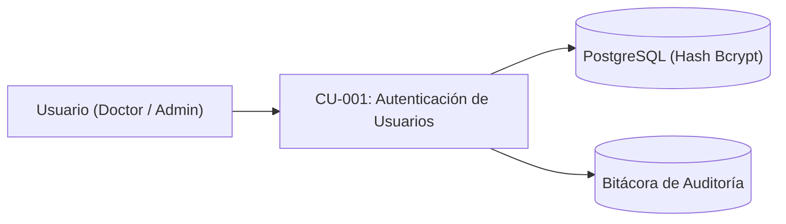

---

#### CU-002: Validación de Rol por Endpoint y Prevención de Acceso Directo (Bypass)

| Campo | Descripción del Contenido |
| :--- | :--- |
| **ID** | CU-002 |
| **Nombre del Caso de Uso** | Validación de Rol por Endpoint y Prevención de Acceso Directo (Bypass) |
| **Descripción** | Interceptar y validar el token JWT y el rol del usuario en cada petición hacia la API y hacia los recursos documentales para autorizar o denegar la ejecución del controlador, evitando vulnerabilidades de acceso directo (*bypass*). |
| **Prioridad** | Alta |
| **Estado / Autor / Fecha** | Aprobado / Raúl Santiago Hallado Abaunza - Dr. Oscar Rueda / 30/10/2026 |
| **Requerimiento / HU Asociada** | RF-02 / HU-02 |
| **Actores** | Servidor Backend (Sistema), Doctor, Administrador |
| **Reglas de Negocio** | - Cumplimiento del control de acceso basado en roles (RBAC) exigido por el Decreto 1074 de 2015. - Las rutas clínicas, analíticas y de expedientes de pacientes son exclusivas del rol Doctor. - Las rutas de gestión de usuarios, lectura de auditoría y métricas RNBD son exclusivas del rol Administrador. - Ningún archivo clínico en la nube ni ruta interna puede ser consultada mediante URL directa sin pasar por el middleware de validación del backend (mitigación de *bypass*). |
| **Precondiciones** | Petición HTTPS recibida en un endpoint protegido de la API REST. |
| **Entradas** | Encabezado HTTP `Authorization: Bearer <token>` y ruta/recurso de destino. |
| **Flujo Básico** | 1. El cliente envía una petición HTTPS hacia un endpoint protegido. 2. El middleware de autenticación extrae el token del encabezado `Authorization`. 3. El sistema valida la firma criptográfica HMAC-SHA256 y la vigencia temporal del JWT. 4. El middleware de autorización extrae el rol contenido en el token y lo compara contra los permisos requeridos por el endpoint. 5. El sistema aprueba el acceso y transfiere la ejecución al controlador de negocio correspondiente. |
| **Flujo Alternativo** | 4a. Rutas compartidas (ej. registro básico de pacientes o consulta de catálogo): El sistema autoriza a los roles Doctor y Administrador según la matriz RBAC. |
| **Excepciones** | 2a. Intento de acceso directo (*bypass*) sin encabezado `Authorization` o con formato incorrecto: El sistema rechaza la petición con HTTP 401 Unauthorized y registra el intento en auditoría. 3a. Token expirado o firma inválida: El sistema responde con HTTP 401 Unauthorized. 4b. Rol sin privilegios suficientes: El sistema responde con HTTP 403 Forbidden y detiene el procesamiento. |
| **Salidas** | Autorización concedida al controlador o respuesta HTTP con código de error 401 / 403. |
| **Postcondiciones** | La operación se ejecuta únicamente si el rol del solicitante cumple la política de seguridad RBAC. |
| **Criterios de Aceptación** | - Rechazo del 100% de peticiones sin token, con token alterado o por intento de *bypass* directo. - Bloqueo estricto del Administrador al intentar acceder a notas clínicas. - Bloqueo estricto del Doctor al intentar acceder a gestión de usuarios o bitácora de auditoría. |
| **Diagrama de Caso de Uso** | *Ver representación gráfica a continuación* |

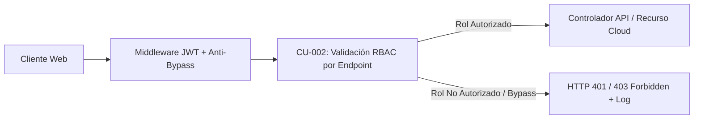

---

#### CU-003: Administración de Usuarios

| Campo | Descripción del Contenido |
| :--- | :--- |
| **ID** | CU-003 |
| **Nombre del Caso de Uso** | Administración de Usuarios |
| **Descripción** | Permitir al Administrador registrar nuevos usuarios en el sistema, conmutar su estado entre activo e inactivo, y actualizar sus contraseñas. |
| **Prioridad** | Media |
| **Estado / Autor / Fecha** | Aprobado / Raúl Santiago Hallado Abaunza - Dr. Oscar Rueda / 30/10/2026 |
| **Requerimiento / HU Asociada** | RF-03 / HU-03 |
| **Actores** | Administrador |
| **Reglas de Negocio** | - El nombre de usuario (`username`) debe ser único en el sistema. - La contraseña debe contener un mínimo de 8 caracteres y ser almacenada como hash bcrypt. - El rol asignado debe pertenecer al catálogo predefinido (Doctor o Administrador). |
| **Precondiciones** | Sesión activa con rol Administrador. |
| **Entradas** | Nombre completo, identificador de usuario (`username`), contraseña (`password`), rol asignado y estado inicial. |
| **Flujo Básico** | 1. El Administrador ingresa al módulo de "Usuarios". 2. El sistema despliega el listado de usuarios con su rol y estado. 3. El Administrador pulsa "Crear Usuario" y completa el formulario. 4. El sistema valida los datos obligatorios y la unicidad del nombre de usuario. 5. El sistema calcula el hash bcrypt de la contraseña y persiste el registro en PostgreSQL. 6. El sistema inserta un registro del evento en la bitácora de auditoría. 7. El sistema actualiza la lista en pantalla y notifica el éxito de la operación. |
| **Flujo Alternativo** | 3a. Modificación de estado / contraseña: El Administrador selecciona un usuario existente, cambia su estado (activo/inactivo) o ingresa una nueva contraseña, y confirma los cambios. |
| **Excepciones** | 4a. Nombre de usuario ya existente: El sistema rechaza la solicitud indicando que el identificador está duplicado. 4b. Contraseña con longitud insuficiente: El sistema impide el guardado y resalta el campo. |
| **Salidas** | Usuario registrado o actualizado en base de datos y mensaje de confirmación en pantalla. |
| **Postcondiciones** | El usuario queda disponible para autenticarse, o sus credenciales/estado se actualizan de inmediato. |
| **Criterios de Aceptación** | - Almacenamiento exclusivo del hash bcrypt en la base de datos. - Imposibilidad de crear identificadores duplicados. - Usuario desactivado pierde inmediatamente la capacidad de iniciar sesión. |
| **Diagrama de Caso de Uso** | *Ver representación gráfica a continuación* |

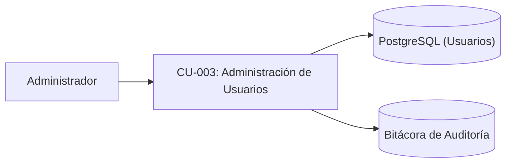

---

### Módulo 2: Gestión de Pacientes y Cumplimiento de Habeas Data

#### CU-004: Registro de Datos Demográficos

| Campo | Descripción del Contenido |
| :--- | :--- |
| **ID** | CU-004 |
| **Nombre del Caso de Uso** | Registro de Datos Demográficos |
| **Descripción** | Capturar, validar y registrar en el sistema la información personal e identificatoria de un nuevo paciente, vinculándola con su estado de consentimiento informado. |
| **Prioridad** | Alta |
| **Estado / Autor / Fecha** | Aprobado / Raúl Santiago Hallado Abaunza - Dr. Oscar Rueda / 30/10/2026 |
| **Requerimiento / HU Asociada** | RF-04 / HU-04 |
| **Actores** | Doctor, Administrador |
| **Reglas de Negocio** | - Campos obligatorios: tipo de documento, número de identificación, nombres, apellidos, fecha de nacimiento, sexo biológico y teléfono. - El número de identificación debe ser único para cada paciente. - La fecha de nacimiento no puede ser posterior a la fecha actual. - Para habilitar el procesamiento clínico y analítico del paciente, debe encontrarse registrado su consentimiento informado (ver `CU-017`). |
| **Precondiciones** | Usuario autenticado en el sistema en la sección de pacientes. |
| **Entradas** | Tipo de documento, número de identificación, nombres, apellidos, fecha de nacimiento, sexo biológico, teléfono, correo electrónico (opcional), ocupación (opcional), dirección (opcional). |
| **Flujo Básico** | 1. El actor pulsa el botón "Nuevo Paciente". 2. El sistema despliega el formulario de captura demográfica junto con la sección de autorización de tratamiento de datos personales (`CU-017`). 3. El actor ingresa los datos y presiona "Guardar Paciente". 4. El sistema valida los campos obligatorios y el formato de la información. 5. El sistema comprueba que no exista otro paciente con el mismo número de documento. 6. El sistema almacena el registro en la base de datos relacional PostgreSQL. 7. El sistema registra el evento en la bitácora de auditoría. 8. El sistema muestra mensaje de confirmación y actualiza el listado de pacientes. |
| **Flujo Alternativo** | 3a. Edición de datos demográficos: El actor selecciona un paciente existente, actualiza los campos permitidos y guarda los cambios en apego al derecho de actualización y rectificación (Habeas Data). |
| **Excepciones** | 4a. Campos obligatorios incompletos o fecha inválida: El sistema resalta los campos con error y cancela el guardado. 5a. Número de documento duplicado: El sistema notifica que el paciente ya está registrado y ofrece abrir su expediente. |
| **Salidas** | Registro de paciente persistido en base de datos y confirmación visual en pantalla. |
| **Postcondiciones** | El paciente queda registrado en el directorio digital del consultorio. |
| **Criterios de Aceptación** | - Validación estricta de todos los campos obligatorios antes de enviar a base de datos. - Rechazo sistemático de números de documento duplicados. - Disponibilidad inmediata del paciente registrado para consultas clínicas una vez otorgado el consentimiento informado. |
| **Diagrama de Caso de Uso** | *Ver representación gráfica a continuación* |

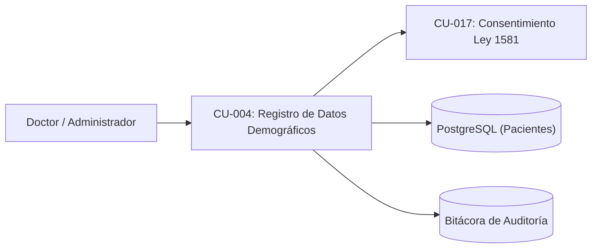

---

#### CU-005: Búsqueda de Pacientes por Criterio

| Campo | Descripción del Contenido |
| :--- | :--- |
| **ID** | CU-005 |
| **Nombre del Caso de Uso** | Búsqueda de Pacientes por Criterio |
| **Descripción** | Localizar expedientes de pacientes mediante filtrado predictivo por número de identificación, nombres o apellidos. |
| **Prioridad** | Alta |
| **Estado / Autor / Fecha** | Aprobado / Raúl Santiago Hallado Abaunza - Dr. Oscar Rueda / 30/10/2026 |
| **Requerimiento / HU Asociada** | RF-05 / HU-05 |
| **Actores** | Doctor, Administrador |
| **Reglas de Negocio** | - La búsqueda debe coincidir con subcadenas sin distinguir entre mayúsculas, minúsculas ni tildes. - La respuesta debe procesarse de manera asíncrona optimizada para consultas en tiempo real hacia el backend en la nube. |
| **Precondiciones** | Usuario autenticado en el sistema; existen registros de pacientes en la base de datos. |
| **Entradas** | Cadena de texto ingresada en la barra de búsqueda (documento, nombres o apellidos). |
| **Flujo Básico** | 1. El actor ingresa texto en el campo de búsqueda de pacientes. 2. El sistema envía la solicitud de búsqueda al servidor backend. 3. El sistema ejecuta la consulta SQL indexada filtrando por coincidencia parcial en identificación, nombres o apellidos. 4. El sistema retorna los registros coincidentes. 5. El sistema renderiza la tabla de resultados mostrando identificación, nombre completo, edad, sexo, teléfono y estado de consentimiento. |
| **Flujo Alternativo** | 1a. Si el campo de búsqueda queda vacío, el sistema despliega el listado paginado de pacientes ordenado según criterio por defecto. |
| **Excepciones** | 4a. Cero coincidencias: El sistema muestra el mensaje "No se encontraron pacientes que coincidan con el criterio ingresado" y habilita el botón para crear un nuevo registro. |
| **Salidas** | Lista interactiva de pacientes filtrados según el término digitado. |
| **Postcondiciones** | El actor puede seleccionar un paciente específico para consultar su ficha o iniciar atención. |
| **Criterios de Aceptación** | - Retorno de resultados en menos de 300 ms con instancia cloud activa (sin *cold start*). - Búsqueda insensible a mayúsculas, minúsculas y tildes. |
| **Diagrama de Caso de Uso** | *Ver representación gráfica a continuación* |

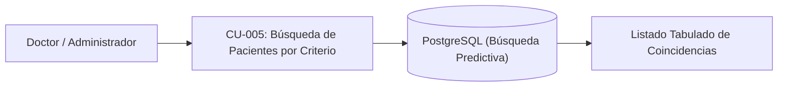

---

#### CU-006: Ficha Consolidada del Paciente

| Campo | Descripción del Contenido |
| :--- | :--- |
| **ID** | CU-006 |
| **Nombre del Caso de Uso** | Ficha Consolidada del Paciente |
| **Descripción** | Desplegar en una vista integral y centralizada la información demográfica, el estado de consentimiento informado, el registro de alergias y el compendio histórico de notas de consulta del paciente. |
| **Prioridad** | Alta |
| **Estado / Autor / Fecha** | Aprobado / Raúl Santiago Hallado Abaunza - Dr. Oscar Rueda / 30/10/2026 |
| **Requerimiento / HU Asociada** | RF-06 / HU-06 |
| **Actores** | Doctor |
| **Reglas de Negocio** | - El expediente clínico y el historial de consultas solo pueden ser leídos por el rol Doctor (Ley 2015 de 2020 y Decreto 1074 de 2015). - Las notas de consulta deben presentarse ordenadas descendentemente por fecha (de la más reciente a la más antigua). - La apertura del expediente debe registrarse obligatoriamente en la bitácora de auditoría (Resolución 1995 de 1999). |
| **Precondiciones** | Paciente registrado en el sistema; sesión activa con rol Doctor. |
| **Entradas** | Identificador del paciente (`id_paciente`) seleccionado del listado de pacientes. |
| **Flujo Básico** | 1. El Doctor selecciona un paciente de la lista. 2. El sistema solicita al backend el expediente completo del paciente. 3. El sistema valida los permisos del rol Doctor. 4. El sistema consulta datos demográficos, estado de consentimiento informado, alergias registradas y notas de consulta vinculadas. 5. El sistema registra el evento de lectura de expediente en la bitácora de auditoría. 6. El sistema renderiza la ficha consolidada: tarjeta demográfica, bloque de alergias, resumen de última visita, enlaces a soportes en la nube y lista cronológica de notas. |
| **Flujo Alternativo** | 6a. Paciente nuevo sin consultas previas: El sistema despliega los datos demográficos y muestra el mensaje indicando que no registra notas clínicas previas, habilitando el botón "Iniciar Consulta". |
| **Excepciones** | 3a. Usuario con rol Administrador intenta acceder a la ficha clínica: El sistema responde con HTTP 403 Forbidden y redirige a la vista permitida. 4a. Identificador de paciente inexistente: El sistema responde con HTTP 404 Not Found y muestra un mensaje de error. |
| **Salidas** | Vista gráfica de la ficha consolidada del paciente con resumen clínico y acciones operativas. |
| **Postcondiciones** | Expediente visualizado y auditado; Doctor listo para registrar evolución o examinar antecedentes. |
| **Criterios de Aceptación** | - Despliegue prominente del estado de alergias (incluyendo condición NKDA). - Orden cronológico descendente riguroso de las consultas. - Registro obligatorio del evento en la bitácora de auditoría. |
| **Diagrama de Caso de Uso** | *Ver representación gráfica a continuación* |

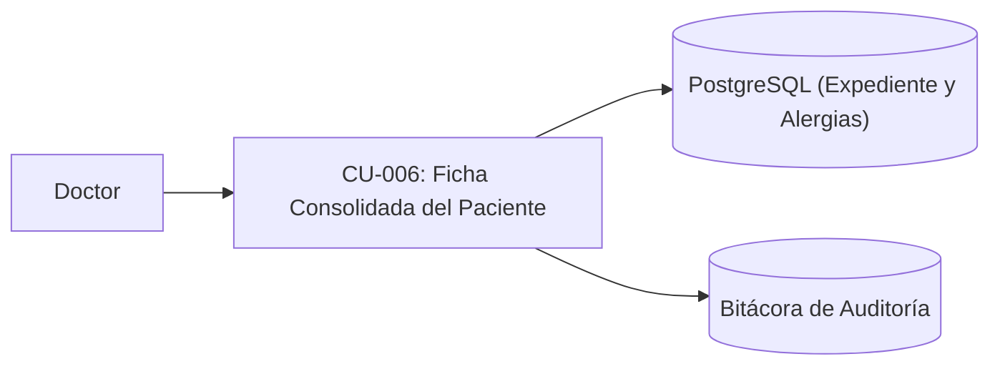

---

#### CU-017: Gestión de Consentimiento Informado, Habeas Data y Métricas RNBD

| Campo | Descripción del Contenido |
| :--- | :--- |
| **ID** | CU-017 |
| **Nombre del Caso de Uso** | Gestión de Consentimiento Informado, Habeas Data y Métricas RNBD |
| **Descripción** | Garantizar la obtención, registro inalterable y verificación del consentimiento explícito, previo e informado del paciente para el tratamiento de datos sensibles con finalidad asistencial y analítica (Ley 1581 de 2012), así como proveer las métricas de cumplimiento requeridas para el Registro Nacional de Bases de Datos (RNBD - SIC) bajo el Decreto 1074 de 2015. |
| **Prioridad** | Alta |
| **Estado / Autor / Fecha** | Aprobado / Raúl Santiago Hallado Abaunza - Dr. Oscar Rueda / 30/10/2026 |
| **Requerimiento / HU Asociada** | RF-17 / HU-17 |
| **Actores** | Doctor (captura de consentimiento), Administrador (consulta de métricas RNBD) |
| **Reglas de Negocio** | - En cumplimiento de los artículos 5 y 6 de la Ley 1581 de 2012, los expedientes médicos son datos sensibles; queda prohibido su tratamiento clínico o analítico sin el consentimiento explícito, previo e informado del titular. - El registro de consentimiento debe especificar por separado la autorización para: (1) gestión de historia clínica electrónica y (2) procesamiento anonimizado/agregado con fines de analítica clínica. - El Administrador puede consultar únicamente métricas cuantitativas consolidadas (total de titulares registrados, total de consentimientos activos/revocados y políticas vigentes) para la inscripción y actualización ante el RNBD de la SIC (Decreto 1074 de 2015), sin acceder a datos clínicos. |
| **Precondiciones** | Usuario autenticado en el sistema (Doctor durante el registro/atención del paciente o Administrador en el panel normativo). |
| **Entradas** | Identificador del paciente, aceptación explícita de las cláusulas de tratamiento de datos (asistencial y analítica), medio de constancia (digital o soporte firmado) y fecha/hora. |
| **Flujo Básico** | 1. Al registrar un paciente o antes de iniciar su primera consulta, el sistema presenta el módulo de Consentimiento Informado y Habeas Data (Ley 1581 de 2012). 2. El Doctor informa al paciente las finalidades del tratamiento (gestión electrónica de su historia clínica y análisis estadístico para soporte a la decisión médica) y registra su autorización explícita. 3. El sistema almacena el registro de consentimiento con marca temporal UTC, versión de la política de privacidad y usuario que certifica. 4. El sistema registra la transacción en la bitácora de auditoría. 5. El sistema habilita el expediente para captura de consultas (`CU-007`) y procesamiento en reportes analíticos (`CU-013`, `CU-014`). |
| **Flujo Alternativo** | 5a. Consulta de métricas para el RNBD (SIC): El Administrador accede al panel "Cumplimiento RNBD", donde el sistema calcula y exporta el consolidado estadístico de titulares y autorizaciones exigido por la Superintendencia de Industria y Comercio. 5b. Ejercicio de derechos de Habeas Data (actualización, rectificación o revocatoria de finalidad analítica): El Doctor registra la solicitud del titular; si el paciente revoca la finalidad analítica, sus registros se excluyen de los cruces estadísticos preservando el archivo legal asistencial exigido por la Resolución 1995 de 1999. |
| **Excepciones** | 2a. Paciente no otorga consentimiento: El sistema bloquea la apertura de la historia clínica electrónica e impide cualquier procesamiento de datos sensibles. |
| **Salidas** | Constancia digital de consentimiento vinculada al paciente; reporte de métricas de cumplimiento para el RNBD (SIC). |
| **Postcondiciones** | El tratamiento de los datos sensibles del paciente cuenta con respaldo jurídico verificable bajo la normativa colombiana. |
| **Criterios de Aceptación** | - Bloqueo del 100% de formularios clínicos si el paciente no posee consentimiento asistencial activo. - Exclusión automática en consultas analíticas (`CU-013`, `CU-014`) si el paciente no autoriza la finalidad analítica. - Generación exacta del resumen cuantitativo de titulares para el RNBD sin exponer información médica al Administrador. |
| **Diagrama de Caso de Uso** | *Ver representación gráfica a continuación* |

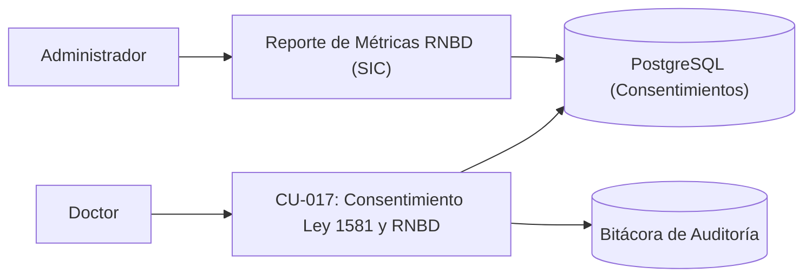

---

### Módulo 3: Historia Clínica Digital, Interconsulta y Almacenamiento en la Nube

#### CU-007: Captura Estructurada de la Consulta

| Campo | Descripción del Contenido |
| :--- | :--- |
| **ID** | CU-007 |
| **Nombre del Caso de Uso** | Captura Estructurada de la Consulta |
| **Descripción** | Guiar al médico en el registro secuencial y estructurado de una consulta inicial o interconsulta a través de un asistente de 3 etapas (Historia, Examen Físico, Plan y Cierre). |
| **Prioridad** | Alta |
| **Estado / Autor / Fecha** | Aprobado / Raúl Santiago Hallado Abaunza - Dr. Oscar Rueda / 30/10/2026 |
| **Requerimiento / HU Asociada** | RF-07 / HU-07 |
| **Actores** | Doctor |
| **Reglas de Negocio** | - La captura debe estructurarse en 3 etapas secuenciales obligatorias. - Las notas guardadas son inmutables (Resolución 1995 de 1999); no se admiten modificaciones retroactivas ni eliminaciones físicas. - El IMC se calcula automáticamente mediante la fórmula: peso (kg) / [talla (m)]². - Se debe respaldar automáticamente el borrador en `LocalStorage` ante cada cambio para evitar pérdidas de datos. |
| **Precondiciones** | Doctor autenticado en el sistema; paciente seleccionado con consentimiento informado activo (`CU-017`). |
| **Entradas** | - *Etapa 1:* Tipo de atención (Visita Inicial / Interconsulta con médico solicitante), alergias (o NKDA), medicación activa con conciliación, motivo de consulta, HPI (8 dimensiones: localización, calidad, duración, temporalidad, severidad, contexto, factores modificadores, síntomas asociados), ROS (14 sistemas corporales) y antecedentes. - *Etapa 2:* Signos vitales (temperatura, pulso, presión arterial, frecuencia respiratoria, peso, talla) y casillas de exploración para 12 sistemas anatómicos más exploración genitourinaria. - *Etapa 3:* Estudios paraclínicos, lista de diagnósticos con código CIE-10, plan de manejo, médico evaluador, fecha y hora. |
| **Flujo Básico** | 1. El Doctor presiona "Iniciar Consulta" en la ficha del paciente. 2. El sistema verifica el consentimiento informado (`CU-017`), despliega la Etapa 1 (Historia) y restaura borrador previo si existe en `LocalStorage`. 3. El Doctor diligencia motivo, HPI, ROS, alergias y antecedentes, y presiona "Siguiente: Examen Físico". 4. El sistema valida los datos de la Etapa 1 y pasa a la Etapa 2 (Examen Físico). 5. El Doctor ingresa los signos vitales; el sistema calcula y muestra instantáneamente el IMC; diligencia la exploración por sistemas y presiona "Siguiente: Plan y Cierre". 6. El sistema valida los datos de la Etapa 2 y muestra la Etapa 3. 7. El Doctor selecciona los códigos CIE-10, redacta la evaluación y plan de manejo, y presiona "Guardar y Finalizar Consulta". 8. El sistema valida la integridad de los datos, persiste la consulta en PostgreSQL y borra el borrador temporal de `LocalStorage`. 9. El sistema registra el evento en la bitácora de auditoría y actualiza la línea de tiempo del paciente. |
| **Flujo Alternativo** | 3a/5a. Navegación libre entre etapas: El Doctor puede retroceder a etapas previas para revisar o completar campos sin perder los datos ya ingresados. |
| **Excepciones** | 4a/6a/8a. Validación fallida (campos obligatorios vacíos, valores no numéricos en signos vitales, o ausencia de diagnóstico): El sistema resalta los campos faltantes e impide avanzar o finalizar. 8b. Falla de conexión o latencia con el backend: El sistema notifica el estado de red, mantiene el borrador intacto en `LocalStorage` y permite reintentar el guardado. |
| **Salidas** | Registro clínico inmutable persistido en base de datos; consulta agregada a la línea de tiempo del paciente. |
| **Postcondiciones** | La consulta queda archivada con timestamp oficial UTC; no puede ser borrada ni sobrescrita. |
| **Criterios de Aceptación** | - Cálculo automático y exacto del IMC. - Persistencia completa de los 14 sistemas ROS y 8 dimensiones HPI. - Respaldo continuo en `LocalStorage` comprobado ante cierre accidental del navegador. |
| **Diagrama de Caso de Uso** | *Ver representación gráfica a continuación* |

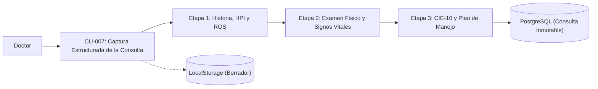

---

#### CU-008: Selección Asistida por Catálogo (Select2)

| Campo | Descripción del Contenido |
| :--- | :--- |
| **ID** | CU-008 |
| **Nombre del Caso de Uso** | Selección Asistida por Catálogo (Select2) |
| **Descripción** | Proporcionar componentes de búsqueda asistida con debounce para la selección ágil de términos predefinidos en alergias, medicamentos, antecedentes y diagnósticos CIE-10, permitiendo la creación de nuevos términos sobre la marcha. |
| **Prioridad** | Alta |
| **Estado / Autor / Fecha** | Aprobado / Raúl Santiago Hallado Abaunza - Dr. Oscar Rueda / 30/10/2026 |
| **Requerimiento / HU Asociada** | RF-08 / HU-08 |
| **Actores** | Doctor |
| **Reglas de Negocio** | - La consulta al backend debe emitirse tras un retraso de inactividad (debounce) de 200 ms para optimizar el tráfico hacia el servidor en la nube. - Si el término digitado por el médico no existe en el catálogo, debe permitirse agregarlo como una opción personalizada (etiquetado "Crear nuevo"). |
| **Precondiciones** | Formulario de consulta activo en la interfaz de usuario. |
| **Entradas** | Texto digitado por el médico en el campo selector de catálogo. |
| **Flujo Básico** | 1. El Doctor escribe los primeros caracteres en el campo de selección (ej. nombre de fármaco o código CIE-10). 2. El componente espera 200 ms desde la última pulsación de tecla. 3. El sistema realiza una petición HTTPS al endpoint de catálogos (`/api/catalogos/:categoria?q=...`). 4. El sistema backend consulta la tabla correspondiente y devuelve las coincidencias. 5. El componente despliega un menú desplegable con las opciones encontradas. 6. El Doctor selecciona la opción deseada y el sistema la añade a la lista de selecciones activas. |
| **Flujo Alternativo** | 5a. Término no existente en el catálogo: El componente muestra la opción "Agregar: [término digitado]". El Doctor la selecciona, el sistema la asigna al campo y emite el guardado dinámico en el catálogo. |
| **Excepciones** | 3a. Error de conexión con el catálogo backend: El componente permite al médico ingresar el valor como texto libre sin bloquear el diligenciamiento. |
| **Salidas** | Término clínico estandarizado o personalizado incorporado al formulario. |
| **Postcondiciones** | El dato queda estructurado para almacenamiento y posterior análisis estadístico. |
| **Criterios de Aceptación** | - Activación de la petición tras exactamente 200 ms de inactividad de teclado. - Respuesta visual del selector en menos de 300 ms con instancia cloud activa. - Admisión transparente de términos nuevos. |
| **Diagrama de Caso de Uso** | *Ver representación gráfica a continuación* |

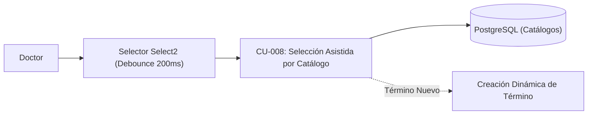

---

#### CU-009: Exportación Imprimible y Copia en Texto Plano

| Campo | Descripción del Contenido |
| :--- | :--- |
| **ID** | CU-009 |
| **Nombre del Caso de Uso** | Exportación Imprimible y Copia en Texto Plano |
| **Descripción** | Generar una representación de la consulta limpia y formateada para impresión física, exportación local en PDF o copia directa en texto plano al portapapeles. |
| **Prioridad** | Media |
| **Estado / Autor / Fecha** | Aprobado / Raúl Santiago Hallado Abaunza - Dr. Oscar Rueda / 30/10/2026 |
| **Requerimiento / HU Asociada** | RF-09 / HU-09 |
| **Actores** | Doctor |
| **Reglas de Negocio** | - La vista de impresión debe ocultar botones, barras de navegación y elementos de interfaz de usuario mediante reglas CSS `@media print`. - El texto plano copiado al portapapeles debe conservar un formato ordenado con saltos de línea claros y secciones identificables. |
| **Precondiciones** | Consulta médica registrada o en pantalla de resumen final. |
| **Entradas** | Clic sobre el botón "Imprimir / Descargar PDF" o "Copiar al Portapapeles". |
| **Flujo Básico** | 1. El Doctor visualiza el resumen de la consulta y presiona "Imprimir Resumen". 2. El sistema aplica las hojas de estilo `@media print`, formateando la consulta para hoja membretada estándar. 3. El sistema invoca el diálogo de impresión nativo del navegador (`window.print()`). 4. El Doctor selecciona la impresora o el destino PDF local y confirma la operación. |
| **Flujo Alternativo** | 1a. El Doctor presiona "Copiar al Portapapeles": El sistema procesa todos los campos de la consulta en una cadena estructurada en texto plano, la transfiere al portapapeles del sistema operativo y muestra una notificación temporal de confirmación. |
| **Excepciones** | 1b. Bloqueo de permisos de portapapeles en el navegador: El sistema despliega un área de texto modal con el texto seleccionado para que el médico lo copie manualmente con Ctrl+C. |
| **Salidas** | Documento físico/PDF formateado o texto plano copiado en el portapapeles del sistema. |
| **Postcondiciones** | Ninguna alteración sobre los datos almacenados en la base de datos. |
| **Criterios de Aceptación** | - La versión impresa no debe mostrar elementos de UI (botones, menús, barras de desplazamiento). - El contenido copiado en texto plano debe incluir encabezados claros de HPI, ROS, signos vitales, diagnósticos y plan. |
| **Diagrama de Caso de Uso** | *Ver representación gráfica a continuación* |

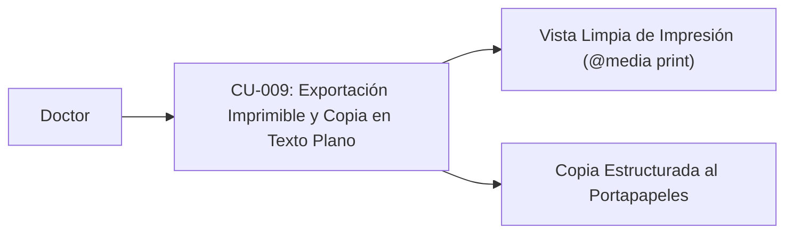

---

#### CU-018: Sincronización y Respaldo Documental en la Nube (API de Google Drive / Google Cloud)

| Campo | Descripción del Contenido |
| :--- | :--- |
| **ID** | CU-018 |
| **Nombre del Caso de Uso** | Sincronización y Respaldo Documental en la Nube (API de Google Drive / Google Cloud) |
| **Descripción** | Almacenar y gestionar en la nube el soporte documental generado para cada historia clínica integrando la API de Google Drive en el prototipo funcional y proyectando su migración hacia almacenamiento privado en Google Cloud, garantizando control de acceso mediado por el backend para evitar vulnerabilidades de acceso directo (*bypass*). |
| **Prioridad** | Alta |
| **Estado / Autor / Fecha** | Aprobado / Raúl Santiago Hallado Abaunza - Dr. Oscar Rueda / 30/10/2026 |
| **Requerimiento / HU Asociada** | RF-18 / HU-18 |
| **Actores** | Doctor, Servidor Backend (Integración Cloud) |
| **Reglas de Negocio** | - Toda comunicación con la API de Google Drive (prototipo) o Cloud Storage (producción en Google Cloud) debe realizarse desde el servidor backend mediante credenciales de servicio u OAuth2 seguras, nunca exponiendo llaves privadas en el frontend. - Los documentos clínicos alojados en la nube no deben poseer enlaces públicos abiertos; su lectura o descarga debe estar mediada por el backend previa verificación del token JWT y del rol Doctor (`CU-002`) para erradicar vulnerabilidades de *bypass* de acceso directo. - Cada sincronización o descarga documental debe quedar registrada en la bitácora de auditoría (`CU-015`). |
| **Precondiciones** | Consulta médica finalizada (`CU-007`) y sesión activa con rol Doctor. |
| **Entradas** | Identificador de la consulta (`id_consulta`), contenido estructurado/PDF de la historia clínica y metadatos del expediente. |
| **Flujo Básico** | 1. Al finalizar el guardado de la consulta o al pulsar "Respaldar en Nube", el cliente solicita al backend la sincronización documental. 2. El servidor backend verifica el token JWT y el rol Doctor. 3. El backend estructura el documento clínico y se autentica ante la API de Google Drive (o el bucket privado en Google Cloud). 4. El servicio en la nube almacena el archivo en el directorio seguro del consultorio y retorna el identificador único del archivo (`fileId`). 5. El backend asocia el `fileId` al registro de la consulta en PostgreSQL. 6. El backend registra la operación en la bitácora de auditoría y confirma al médico la sincronización exitosa. |
| **Flujo Alternativo** | 6a. Consulta posterior del soporte en la nube: El Doctor solicita abrir el documento desde la ficha del paciente; el backend valida su JWT, recupera el flujo del archivo o emite un acceso temporal firmado y registra la lectura en auditoría. |
| **Excepciones** | 3a. Latencia o interrupción de conexión con la API de Google Drive: El backend conserva el registro íntegro en PostgreSQL, marca el estado de sincronización como "Pendiente de respaldo cloud" y habilita el reintento automático o manual. 6b. Intento de acceso directo (*bypass*) al archivo sin sesión válida de Doctor: El sistema deniega el acceso con HTTP 403 Forbidden. |
| **Salidas** | Archivo clínico respaldado en la nube, identificador `fileId` vinculado en PostgreSQL y confirmación en la interfaz. |
| **Postcondiciones** | El expediente cuenta con respaldo documental externo protegido contra pérdida física y contra accesos directos no autorizados. |
| **Criterios de Aceptación** | - Sincronización exitosa del documento mediante la API de Google Drive desde el backend. - Cero exposición de archivos clínicos mediante enlaces públicos sin autenticación (prevención de *bypass*). - Registro auditable de cada carga y descarga documental. |
| **Diagrama de Caso de Uso** | *Ver representación gráfica a continuación* |

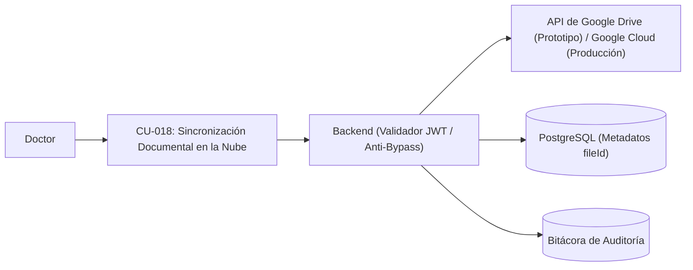

---

### Módulo 4: Seguimiento y Trazabilidad del Paciente

#### CU-010: Línea de Tiempo del Paciente

| Campo | Descripción del Contenido |
| :--- | :--- |
| **ID** | CU-010 |
| **Nombre del Caso de Uso** | Línea de Tiempo del Paciente |
| **Descripción** | Mostrar gráficamente el historial secuencial de consultas, evoluciones e interconsultas del paciente ordenadas cronológicamente para facilitar el seguimiento clínico. |
| **Prioridad** | Alta |
| **Estado / Autor / Fecha** | Aprobado / Raúl Santiago Hallado Abaunza - Dr. Oscar Rueda / 30/10/2026 |
| **Requerimiento / HU Asociada** | RF-10 / HU-10 |
| **Actores** | Doctor |
| **Reglas de Negocio** | - Los eventos clínicos deben organizarse en orden cronológico estricto según su marca temporal ISO 8601. - Cada hito en la línea de tiempo debe indicar fecha, hora, tipo de atención (inicial o interconsulta), diagnóstico principal CIE-10 y profesional tratante. |
| **Precondiciones** | Paciente seleccionado en la aplicación; sesión activa con rol Doctor. |
| **Entradas** | Clic en la pestaña "Línea de Tiempo" dentro de la ficha del paciente. |
| **Flujo Básico** | 1. El Doctor selecciona la pestaña "Línea de Tiempo" en el expediente del paciente. 2. El sistema recupera el listado de todas las notas clínicas asociadas al paciente en PostgreSQL. 3. El sistema renderiza un componente visual de línea de tiempo con nodos secuenciales. 4. El Doctor visualiza los hitos y puede pulsar sobre cualquier nodo para desplegar el detalle completo de esa consulta. |
| **Flujo Alternativo** | 4a. Paciente sin historial previo: El sistema muestra un mensaje indicativo informando que no existen registros clínicos anteriores para este paciente. |
| **Excepciones** | 2a. Error de conexión con el backend: El sistema notifica que no fue posible cargar la línea de tiempo y ofrece un botón de reintento. |
| **Salidas** | Componente interactivo de línea de tiempo con tarjetas de eventos clínicos. |
| **Postcondiciones** | El Doctor dispone de la perspectiva histórica de la evolución del paciente. |
| **Criterios de Aceptación** | - Orden cronológico verificable por fecha y hora. - Despliegue de los detalles completos de una nota clínica al hacer clic en su tarjeta. |
| **Diagrama de Caso de Uso** | *Ver representación gráfica a continuación* |

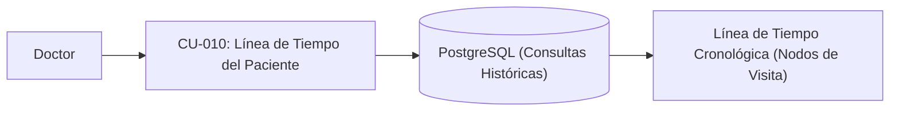

---

#### CU-011: Registro Histórico de Signos Vitales

| Campo | Descripción del Contenido |
| :--- | :--- |
| **ID** | CU-011 |
| **Nombre del Caso de Uso** | Registro Histórico de Signos Vitales |
| **Descripción** | Almacenar y presentar en una tabla comparativa cronológica los signos vitales tomados en cada visita del paciente para evaluar variaciones hemodinámicas en el tiempo. |
| **Prioridad** | Alta |
| **Estado / Autor / Fecha** | Aprobado / Raúl Santiago Hallado Abaunza - Dr. Oscar Rueda / 30/10/2026 |
| **Requerimiento / HU Asociada** | RF-11 / HU-11 |
| **Actores** | Doctor |
| **Reglas de Negocio** | - Cada registro debe conservar: fecha, hora, temperatura (°C), pulso (lpm y regularidad), presión arterial (sistólica/diastólica y posición), frecuencia respiratoria (rpm), peso (kg), talla (m) e IMC calculado. - Los valores deben ser inmutables una vez registrada la consulta. |
| **Precondiciones** | Paciente con al menos una consulta registrada con signos vitales; rol Doctor autenticado. |
| **Entradas** | Clic en la sección "Signos Vitales" dentro del expediente del paciente. |
| **Flujo Básico** | 1. El Doctor accede a la sección de signos vitales dentro del expediente del paciente. 2. El sistema consulta todas las tomas de signos vitales registradas para el paciente. 3. El sistema tabula los datos por fecha y hora en orden cronológico. 4. El sistema resalta visualmente los valores que se encuentren fuera de los rangos fisiológicos estándar. 5. El Doctor compara la evolución de las variables a lo largo de las consultas. |
| **Flujo Alternativo** | 1a. El Doctor filtra el rango de fechas para examinar un periodo específico de visitas. |
| **Excepciones** | 2a. Paciente sin tomas previas: El sistema muestra el mensaje "No hay registros históricos de signos vitales disponibles". |
| **Salidas** | Tabla comparativa de signos vitales con cálculo automático de IMC para cada fecha. |
| **Postcondiciones** | El médico cuenta con evidencia cuantitativa del estado hemodinámico del paciente a lo largo del tiempo. |
| **Criterios de Aceptación** | - Despliegue correcto de todas las variables vitales sin omisiones. - Integridad histórica de los valores numéricos almacenados. |
| **Diagrama de Caso de Uso** | *Ver representación gráfica a continuación* |

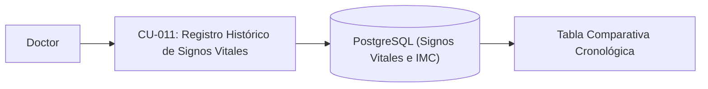

---

#### CU-012: Historial de Prescripciones Farmacológicas

| Campo | Descripción del Contenido |
| :--- | :--- |
| **ID** | CU-012 |
| **Nombre del Caso de Uso** | Historial de Prescripciones Farmacológicas |
| **Descripción** | Consolidar y listar los medicamentos prescritos o registrados a lo largo de las distintas consultas del paciente, facilitando la conciliación y el seguimiento farmacológico. |
| **Prioridad** | Media |
| **Estado / Autor / Fecha** | Aprobado / Raúl Santiago Hallado Abaunza - Dr. Oscar Rueda / 30/10/2026 |
| **Requerimiento / HU Asociada** | RF-12 / HU-12 |
| **Actores** | Doctor |
| **Reglas de Negocio** | - Debe mostrar nombre del fármaco, dosis, frecuencia, vía de administración, estado del tratamiento (continuado, suspendido, modificado, nuevo) y fecha de indicación. |
| **Precondiciones** | Paciente con consultas previas que incluyan registros en la sección de medicación. |
| **Entradas** | Clic en la pestaña "Medicamentos" en la ficha del paciente. |
| **Flujo Básico** | 1. El Doctor ingresa a la pestaña de medicamentos del paciente. 2. El sistema recopila los registros de fármacos vinculados a las diferentes fechas de consulta. 3. El sistema genera una lista consolidada agrupada por medicamento y fecha de última actualización. 4. El Doctor revisa los fármacos activos e históricos para prevenir duplicidades o interacciones. |
| **Flujo Alternativo** | 4a. Durante una nueva consulta (Etapa 1), el sistema precarga automáticamente la medicación de la visita anterior para su conciliación rápida. |
| **Excepciones** | 2a. No existen prescripciones registradas: El sistema muestra el estado "Sin antecedentes farmacológicos registrados". |
| **Salidas** | Lista consolidada de medicamentos clasificados por estado y fecha de prescripción. |
| **Postcondiciones** | Visibilidad clara del tratamiento farmacológico previo para evitar interacciones medicamentosas. |
| **Criterios de Aceptación** | - Identificación precisa del estado de cada prescripción en cada consulta. - Precarga de la medicación activa en la consulta siguiente. |
| **Diagrama de Caso de Uso** | *Ver representación gráfica a continuación* |

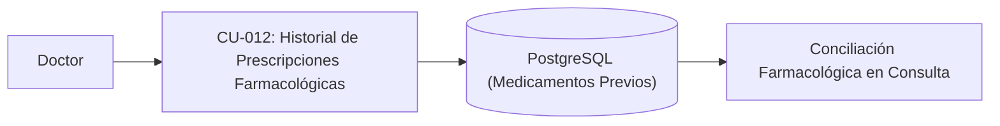

---

### Módulo 5: Análisis Clínico y Estadísticas

#### CU-013: Conteo y Frecuencia de Diagnósticos (CIE-10)

| Campo | Descripción del Contenido |
| :--- | :--- |
| **ID** | CU-013 |
| **Nombre del Caso de Uso** | Conteo y Frecuencia de Diagnósticos (CIE-10) |
| **Descripción** | Calcular y graficar la frecuencia de los códigos diagnósticos CIE-10 registrados en el consultorio, permitiendo acotar los resultados por intervalos de fechas para identificar tendencias clínicas. |
| **Prioridad** | Media |
| **Estado / Autor / Fecha** | Aprobado / Raúl Santiago Hallado Abaunza - Dr. Oscar Rueda / 30/10/2026 |
| **Requerimiento / HU Asociada** | RF-13 / HU-13 |
| **Actores** | Doctor |
| **Reglas de Negocio** | - El cálculo debe procesar únicamente las consultas de pacientes que cuenten con autorización activa para finalidad analítica (Ley 1581 de 2012, `CU-017`). - El filtrado por fecha debe validar que la fecha inicial sea menor o igual a la fecha final. - La visualización debe ordenar los diagnósticos de mayor a menor frecuencia de aparición. |
| **Precondiciones** | Doctor autenticado en el sistema; existen consultas registradas con códigos CIE-10. |
| **Entradas** | Rango de fechas opcional (fecha de inicio y fecha de fin). |
| **Flujo Básico** | 1. El Doctor accede al módulo de "Reportes y Estadísticas". 2. El Doctor selecciona el rango de fechas deseado (o deja el valor por defecto: histórico total) y pulsa "Generar Reporte". 3. El sistema ejecuta una consulta de agregación (`COUNT`, `GROUP BY`) sobre los códigos CIE-10 asociados a las consultas autorizadas en el intervalo dado. 4. El sistema retorna la lista de diagnósticos con su código, descripción y total de ocurrencias. 5. El sistema presenta los datos en una tabla ordenada y en un gráfico de barras interactivo. |
| **Flujo Alternativo** | 2a. El Doctor filtra por código específico o texto descriptivo para conocer la frecuencia puntual de una patología. |
| **Excepciones** | 2b. Fecha inicial posterior a fecha final: El sistema muestra alerta indicando la inconsistencia en el rango y cancela la consulta. 3a. Cero diagnósticos en el rango seleccionado: El sistema muestra el mensaje "No se registran diagnósticos en el periodo especificado". |
| **Salidas** | Tabla estadística y gráfica de frecuencias de diagnósticos CIE-10. |
| **Postcondiciones** | El Doctor obtiene información epidemiológica consolidada para la toma de decisiones clínicas y de gestión. |
| **Criterios de Aceptación** | - Conteo exacto verificado contra los registros individuales autorizados de la base de datos. - Tiempo de generación del reporte menor a 1.0 segundo con instancia cloud activa. |
| **Diagrama de Caso de Uso** | *Ver representación gráfica a continuación* |

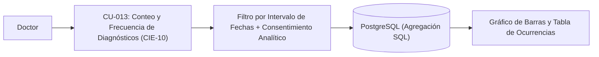

---

#### CU-014: Consulta de Casos por Diagnóstico Compartido

| Campo | Descripción del Contenido |
| :--- | :--- |
| **ID** | CU-014 |
| **Nombre del Caso de Uso** | Consulta de Casos por Diagnóstico Compartido |
| **Descripción** | Permitir al médico seleccionar un código CIE-10 específico y listar los planes de manejo, conductas y evoluciones terapéuticas documentadas en otros pacientes con la misma patología para apoyar la toma de decisiones clínicas basadas en evidencia. |
| **Prioridad** | Media |
| **Estado / Autor / Fecha** | Aprobado / Raúl Santiago Hallado Abaunza - Dr. Oscar Rueda / 30/10/2026 |
| **Requerimiento / HU Asociada** | RF-14 / HU-14 |
| **Actores** | Doctor |
| **Reglas de Negocio** | - La visualización de casos compartidos debe mantener la confidencialidad clínica, incluir únicamente expedientes con consentimiento analítico activo (`CU-017`) y estar restringida exclusivamente al profesional médico autorizado. - Los resultados deben presentar el diagnóstico, el plan de manejo prescrito, la fecha y la evolución observada. |
| **Precondiciones** | Doctor autenticado; existen pacientes con consultas asociadas a dicho código CIE-10. |
| **Entradas** | Código o nombre de patología CIE-10 seleccionado. |
| **Flujo Básico** | 1. El Doctor ingresa a la vista de análisis clínico o selecciona un diagnóstico en el reporte de frecuencias. 2. El Doctor solicita "Ver Casos con este Diagnóstico". 3. El sistema busca todas las consultas médicas con consentimiento analítico que contienen dicho código CIE-10. 4. El sistema agrupa y despliega las notas de evolución, tratamientos instaurados y resultados clínicos asociados a ese diagnóstico. 5. El Doctor analiza los esquemas terapéuticos previos y sus desenlaces para orientar su conducta médica en el caso actual. |
| **Flujo Alternativo** | 1a. El Doctor realiza la consulta cruzada directamente desde el selector de diagnóstico de una consulta en curso. |
| **Excepciones** | 3a. No se registran otros pacientes con ese código: El sistema informa que es la primera vez que se documenta dicha patología en el consultorio. |
| **Salidas** | Panel comparativo de conductas terapéuticas y respuestas clínicas para el diagnóstico seleccionado. |
| **Postcondiciones** | El médico cuenta con evidencia empírica interna del consultorio para apoyar su toma de decisiones. |
| **Criterios de Aceptación** | - Filtrado fidedigno por código CIE-10. - Enlace directo a los planes de manejo documentados. |
| **Diagrama de Caso de Uso** | *Ver representación gráfica a continuación* |

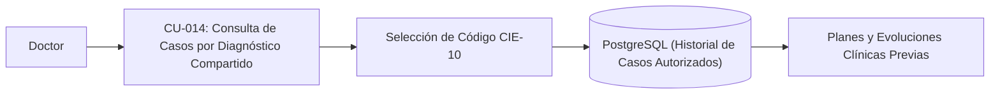

---

### Módulo 6: Auditoría y Catálogos (Administrador)

#### CU-015: Registro de Auditoría de Acciones

| Campo | Descripción del Contenido |
| :--- | :--- |
| **ID** | CU-015 |
| **Nombre del Caso de Uso** | Registro de Auditoría de Acciones |
| **Descripción** | Registrar de forma automática, inmutable y persistente cada acción sensible de lectura, creación, modificación o sincronización cloud ejecutada en el sistema, y permitir su consulta al Administrador en cumplimiento de la Resolución 1995 de 1999. |
| **Prioridad** | Alta |
| **Estado / Autor / Fecha** | Aprobado / Raúl Santiago Hallado Abaunza - Dr. Oscar Rueda / 30/10/2026 |
| **Requerimiento / HU Asociada** | RF-15 / HU-15 |
| **Actores** | Sistema (Automático), Administrador |
| **Reglas de Negocio** | - En cumplimiento de la Resolución 1995 de 1999 del Ministerio de Salud y la Ley 2015 de 2020, la bitácora debe ser estrictamente inmutable (prohibidas las operaciones `UPDATE` y `DELETE` en la tabla y en la API). - Cada registro debe capturar: `id_usuario`, `rol`, `tipo_accion`, `recurso_afectado`, `direccion_ip` y `timestamp` en UTC. - La consulta de la bitácora es privilegio exclusivo del rol Administrador, sin exponer el texto médico confidencial de las notas clínicas. |
| **Precondiciones** | El sistema se encuentra en funcionamiento procesando peticiones. |
| **Entradas** | Evento originado por una petición HTTPS (login, consulta de expediente, registro de consentimiento, guardado de historia, sincronización con Google Drive/Cloud, modificación de usuario o catálogo). |
| **Flujo Básico** | 1. Un actor ejecuta una acción en el sistema (ej. inicio de sesión, lectura de expediente o respaldo documental). 2. El middleware o servicio intercepta la acción y recopila los datos contextuales (usuario, rol, IP, ruta, acción, fecha y hora). 3. El sistema inserta un nuevo registro en la tabla de auditoría de PostgreSQL de manera atómica. 4. El Administrador accede al módulo "Bitácora de Auditoría". 5. El sistema valida el rol de Administrador y despliega los eventos en una tabla ordenada descendentemente por fecha. |
| **Flujo Alternativo** | 4a. El Administrador aplica filtros por usuario, fecha o tipo de acción para investigar un evento o intento de *bypass* específico. |
| **Excepciones** | 3a. Error en la inserción de auditoría: El sistema genera una alerta en los logs del servidor y rechaza la transacción para no permitir operaciones sin auditar. 4b. Rol Doctor intenta acceder a la bitácora: El sistema bloquea el acceso con código HTTP 403 Forbidden. |
| **Salidas** | Registro inmutable en base de datos; vista de monitoreo de auditoría para el Administrador. |
| **Postcondiciones** | Queda trazabilidad forense indeleble de cada interacción con los datos del consultorio. |
| **Criterios de Aceptación** | - Imposibilidad técnica de alterar o borrar registros de la tabla de auditoría. - Registro inmediato y automático en el 100% de las acciones auditables especificadas. |
| **Diagrama de Caso de Uso** | *Ver representación gráfica a continuación* |

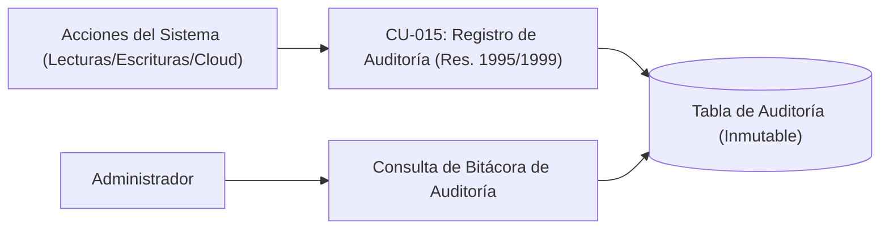

---

#### CU-016: Gestión de Catálogos Médicos

| Campo | Descripción del Contenido |
| :--- | :--- |
| **ID** | CU-016 |
| **Nombre del Caso de Uso** | Gestión de Catálogos Médicos |
| **Descripción** | Administrar y mantener los ítems predefinidos de los catálogos del sistema (alergias, medicamentos, antecedentes patológicos, diagnósticos CIE-10 y motivos de consulta). |
| **Prioridad** | Media |
| **Estado / Autor / Fecha** | Aprobado / Raúl Santiago Hallado Abaunza - Dr. Oscar Rueda / 30/10/2026 |
| **Requerimiento / HU Asociada** | RF-16 / HU-16 |
| **Actores** | Administrador, Doctor (adición en consulta) |
| **Reglas de Negocio** | - Cada ítem del catálogo debe pertenecer a una categoría válida y contar con un término no vacío. - Se debe evitar la duplicidad exacta de términos dentro de la misma categoría. - El Administrador puede gestionar directamente todos los catálogos; el Doctor puede añadir términos nuevos durante la captura clínica. |
| **Precondiciones** | Usuario autenticado con rol Administrador (para gestión global) o Doctor (durante consulta). |
| **Entradas** | Categoría del catálogo, código (opcional) y término/nombre clínico. |
| **Flujo Básico** | 1. El Administrador accede a la sección "Mantenimiento de Catálogos". 2. El sistema despliega el catálogo seleccionado (ej. CIE-10, Medicamentos o Alergias). 3. El Administrador pulsa "Agregar Ítem", digita el código y término, y confirma la acción. 4. El sistema valida que el término no se encuentre duplicado en dicha categoría. 5. El sistema almacena el nuevo ítem en la base de datos relacional PostgreSQL. 6. El sistema registra la acción en la bitácora de auditoría y actualiza la lista. |
| **Flujo Alternativo** | 3a. Modificación de un término existente por parte del Administrador para corregir ortografía o descripción. 3b. Creación dinámica por el Doctor: Durante el diligenciamiento de una consulta, el Doctor digita un término no existente y confirma su inclusión. |
| **Excepciones** | 4a. Término ya existente en la categoría: El sistema informa que el elemento ya se encuentra registrado y cancela la duplicación. |
| **Salidas** | Catálogo actualizado disponible inmediatamente para búsquedas predictivas en todo el sistema. |
| **Postcondiciones** | Los nuevos términos quedan indexados para futuras consultas de autocompletado. |
| **Criterios de Aceptación** | - Disponibilidad instantánea del nuevo término para el componente Select2 sin necesidad de reiniciar el servidor. - Prevención de duplicados exactos en la misma categoría. |
| **Diagrama de Caso de Uso** | *Ver representación gráfica a continuación* |

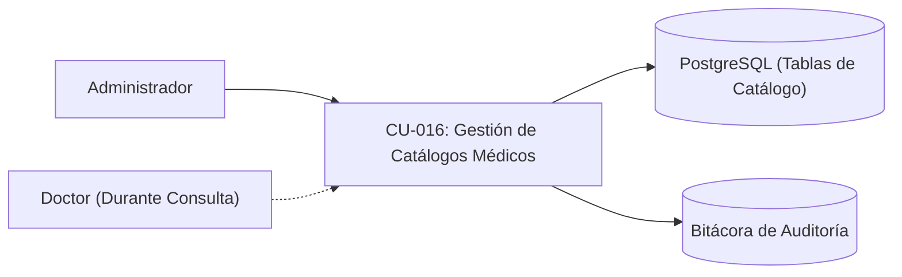

---

## 5. Requerimientos No Funcionales (RNF)

Esta tabla especifica las restricciones técnicas, normativas y atributos de calidad del sistema, alineados con el despliegue del prototipo funcional en la nube (Vercel + Render + PostgreSQL + API de Google Drive), el marco legal colombiano y la proyección de migración a Google Cloud:

| ID | Categoría | Nombre del Requerimiento | Descripción | Métrica / Criterio de Evaluación | Prioridad | Requerimientos Asociados |
| :--- | :--- | :--- | :--- | :--- | :--- | :--- |
| **RNF-001** | Seguridad | Cifrado y Hash de Contraseñas | El sistema debe almacenar todas las contraseñas de las cuentas de usuario procesadas mediante la función de dispersión unidireccional bcrypt, impidiendo el almacenamiento o transmisión en texto claro bajo cualquier circunstancia. | Factor de trabajo (salt rounds) no menor a 10 en todas las operaciones de hash; 0% de contraseñas almacenadas en texto plano en PostgreSQL. | Alta | CU-001 (RF-01), CU-003 (RF-03) |
| **RNF-002** | Seguridad | Firma Digital, Caducidad JWT y Prevención de Bypass | La autenticación de sesiones y el acceso a recursos documentales en la nube deben gestionarse mediante tokens JWT firmados digitalmente por el backend con el algoritmo HMAC-SHA256, bloqueando cualquier intento de acceso directo (*bypass*). | Algoritmo HMAC-SHA256 verificado en cada petición; expiración del token <= 8 horas; rechazo del 100% de tokens vencidos o accesos directos sin mediación del backend. | Alta | CU-001 (RF-01), CU-002 (RF-02), CU-018 (RF-18) |
| **RNF-003** | Rendimiento en la Nube | Tiempo de Respuesta en Búsquedas Predictivas | Las peticiones de búsqueda de pacientes y de términos en los catálogos médicos (Select2) hacia el servicio cloud deben responder de forma ágil para no interrumpir la atención médica. | Latencia de respuesta en backend menor o igual a 300 ms con instancia activa en la nube (Render en caliente / Google Cloud) para catálogos de hasta 10.000 registros, con debounce en frontend de 200 ms. | Alta | CU-005 (RF-05), CU-008 (RF-08) |
| **RNF-004** | Rendimiento y Disponibilidad Cloud | Tiempo de Carga Inicial y Mitigación de Cold Starts | El frontend desplegado en la nube (Vercel / Google Cloud) debe presentar el contenido interactivo rápidamente, y la arquitectura de producción proyectada en Google Cloud debe eliminar la latencia de arranque en frío (*cold starts*) identificada en la capa gratuita de Render. | First Contentful Paint (FCP) menor a 2.0 segundos desde el CDN cloud; reducción de tiempos de *cold start* (superiores a 30-50 s en capa gratuita de Render) a menos de 1.0 segundo en el entorno proyectado de Google Cloud. | Alta | CU-001 al CU-018 (Todos los casos de uso) |
| **RNF-005** | Integridad / Confiabilidad | Estandarización e Integridad Temporal | Todas las fechas y marcas de tiempo capturadas para consultas, consentimientos, signos vitales y eventos de auditoría deben almacenarse de forma unificada para garantizar la trazabilidad cronológica fidedigna. | 100% de las marcas de tiempo almacenadas como tipo `TIMESTAMP WITH TIME ZONE` en formato ISO 8601 (UTC). | Alta | CU-007 (RF-07), CU-010 (RF-10), CU-011 (RF-11), CU-015 (RF-15), CU-017 (RF-17) |
| **RNF-006** | Usabilidad / Resiliencia | Retención Local del Estado de Captura (LocalStorage) | La aplicación cliente debe proteger al médico contra pérdidas accidentales de información por cierre de ventana, recarga fortuita o latencia de red en la nube, persistiendo en tiempo real el borrador de la historia clínica en el navegador. | Sincronización automática en `localStorage` en menos de 100 ms tras cada cambio de campo; restauración automática del 100% de los datos al recargar la página antes del guardado final. | Alta | CU-007 (RF-07), CU-008 (RF-08) |
| **RNF-007** | Seguridad / Marco Legal Salud | Inmutabilidad Absoluta de Historias y Bitácora (Res. 1995/1999 y Ley 2015/2020) | Los registros clínicos guardados y los eventos de la tabla de auditoría deben ser inalterables y no eliminables una vez escritos, preservando la validez clínica, legal y forense exigida por la Resolución 1995 de 1999 y la Ley 2015 de 2020 (HCEI). | 0 rutas HTTP y 0 procedimientos en base de datos que ejecuten sentencias `UPDATE` o `DELETE` sobre notas clínicas cerradas o sobre la tabla de auditoría. | Alta | CU-007 (RF-07), CU-015 (RF-15) |
| **RNF-008** | Portabilidad / Compatibilidad | Compatibilidad Multi-Navegador | La interfaz web debe operar sin distorsiones estéticas, excepciones de JavaScript ni bloqueos funcionales en los principales navegadores web utilizados en entornos médicos y administrativos. | 0 errores de consola y funcionalidad al 100% en las 2 versiones estables más recientes de Google Chrome, Mozilla Firefox y Microsoft Edge. | Media | CU-001 al CU-018 (Todos los casos de uso) |
| **RNF-009** | Disponibilidad / Resiliencia | Tolerancia a Fallos de Conexión a Base de Datos y Servicios Cloud | Si la base de datos PostgreSQL o la API de Google Drive presentan indisponibilidad temporal durante la ejecución del prototipo, el servidor backend debe mantener la continuidad operativa mediante su capa de contingencia y registrar el evento en consola. | Disponibilidad de servicio HTTP del 100% ante fallos transitorios de conexión, activando respaldo temporal y registrando log de contingencia sin abortar el proceso Node.js. | Media | CU-001 al CU-018 (Todos los casos de uso) |
| **RNF-010** | Legal / Normativo (Habeas Data) | Cumplimiento de Ley 1581 de 2012, Decreto 1074 de 2015 y RNBD (SIC) | El software debe garantizar el derecho constitucional al Habeas Data (Art. 15 C.P.), exigir consentimiento previo, expreso e informado para datos sensibles y facilitar las métricas para el Registro Nacional de Bases de Datos (RNBD) ante la SIC. | 100% de expedientes procesados en analítica con registro verificable de consentimiento informado activo; disponibilidad del reporte estadístico de titulares y políticas para el RNBD. | Alta | CU-002 (RF-02), CU-004 (RF-04), CU-013 (RF-13), CU-014 (RF-14), CU-017 (RF-17) |
| **RNF-011** | Arquitectura / Escalabilidad Cloud | Portabilidad hacia Infraestructura de Producción en Google Cloud | El diseño en capas del backend, el esquema en PostgreSQL y el módulo de almacenamiento documental deben estar desacoplados mediante variables de entorno y adaptadores para permitir la migración transparente desde el prototipo (Vercel + Render + Google Drive API) hacia Google Cloud. | 100% de credenciales, orígenes CORS, cadenas de conexión PostgreSQL y parámetros de almacenamiento externalizados en variables de entorno, permitiendo el despliegue en Google Cloud sin reescribir la lógica de negocio. | Alta | CU-001 (RF-01), CU-002 (RF-02), CU-018 (RF-18) |

---

## 6. Matriz de Roles y Permisos (RBAC - Decreto 1074 de 2015)

| Operación del Sistema | Caso de Uso / RF / HU Asociado | Administrador (Encargado Técnico) | Doctor (Responsable Clínico) |
| :--- | :--- | :---: | :---: |
| Autenticación con usuario y contraseña | **CU-001** (RF-01 / HU-01) | Habilitado | Habilitado |
| Validación de rol por endpoint y prevención de *bypass* | **CU-002** (RF-02 / HU-02) | Habilitado | Habilitado |
| Crear y modificar cuentas de usuario | **CU-003** (RF-03 / HU-03) | Habilitado | Inhabilitado |
| Registrar y actualizar datos demográficos de pacientes | **CU-004** (RF-04 / HU-04) | Habilitado | Habilitado |
| Búsqueda de pacientes por criterio | **CU-005** (RF-05 / HU-05) | Habilitado | Habilitado |
| Consultar ficha consolidada del paciente | **CU-006** (RF-06 / HU-06) | Inhabilitado | Habilitado |
| Registrar consulta o interconsulta médica estructurada | **CU-007** (RF-07 / HU-07) | Inhabilitado | Habilitado |
| Selección asistida por catálogos (Select2) | **CU-008** (RF-08 / HU-08) | Inhabilitado | Habilitado |
| Exportación imprimible y copia en texto plano | **CU-009** (RF-09 / HU-09) | Inhabilitado | Habilitado |
| Visualizar línea de tiempo del paciente | **CU-010** (RF-10 / HU-10) | Inhabilitado | Habilitado |
| Consultar registro histórico de signos vitales | **CU-011** (RF-11 / HU-11) | Inhabilitado | Habilitado |
| Consultar historial de prescripciones farmacológicas | **CU-012** (RF-12 / HU-12) | Inhabilitado | Habilitado |
| Consultar reporte estadístico de diagnósticos (CIE-10) | **CU-013** (RF-13 / HU-13) | Inhabilitado | Habilitado |
| Filtrar casos clínicos por diagnóstico compartido | **CU-014** (RF-14 / HU-14) | Inhabilitado | Habilitado |
| Consultar bitácora de auditoría (Resolución 1995 de 1999) | **CU-015** (RF-15 / HU-15) | Habilitado | Inhabilitado |
| Gestión y mantenimiento de catálogos médicos | **CU-016** (RF-16 / HU-16) | Habilitado | Habilitado (durante la captura) |
| Capturar consentimiento informado (Ley 1581) / Consultar métricas RNBD (SIC) | **CU-017** (RF-17 / HU-17) | Habilitado (solo métricas RNBD) | Habilitado (captura y verificación clínica) |
| Sincronizar y respaldar documentos en Google Drive API / Google Cloud | **CU-018** (RF-18 / HU-18) | Inhabilitado | Habilitado |

---

## 7. Matriz de Cobertura: Requerimientos vs. Problemática y Hallazgos del Prototipo

| Factor Identificado en el Trabajo de Grado | Limitación Operativa o Técnica | Caso de Uso, HU y Requerimiento de Solución | Criterio de Verificación |
| :--- | :--- | :--- | :--- |
| **Almacenamiento físico en papel** | Demora en la búsqueda de antecedentes y riesgo de deterioro o pérdida física del expediente. | **CU-004 (RF-04/HU-04), CU-005 (RF-05/HU-05), CU-006 (RF-06/HU-06), CU-018 (RF-18/HU-18)** | Búsqueda predictiva menor a 300 ms en instancia activa y respaldo documental automatizado en la nube (Google Drive API / Google Cloud). |
| **Pérdida de trazabilidad cronológica** | Dificultad para ordenar secuencialmente hojas físicas de diferentes fechas y auditar accesos. | **CU-007 (RF-07/HU-07), CU-010 (RF-10/HU-10), CU-011 (RF-11/HU-11), CU-015 (RF-15/HU-15), RNF-005, RNF-007** | Línea de tiempo ordenada por timestamp ISO 8601 UTC e inmutabilidad estricta en cumplimiento de la Resolución 1995 de 1999. |
| **Privacidad de datos sensibles y vulnerabilidades de *bypass*** | Exposición de carpetas físicas o accesos directos no autorizados (*bypass*) a recursos en la nube; exigencias de la Ley 1581 de 2012. | **CU-001 (RF-01/HU-01), CU-002 (RF-02/HU-02), CU-017 (RF-17/HU-17), CU-018 (RF-18/HU-18), RNF-001, RNF-002, RNF-010** | Validación JWT/RBAC obligatoria por endpoint, bloqueo de enlaces públicos directos, consentimiento informado previo y métricas para el RNBD (SIC). |
| **Ausencia de analítica clínica para toma de decisiones** | Imposibilidad de cruzar manualmente historias en papel para identificar tendencias diagnósticas o eficacia de tratamientos previos. | **CU-012 (RF-12/HU-12), CU-013 (RF-13/HU-13), CU-014 (RF-14/HU-14)** | Conteo automatizado de frecuencias CIE-10 por fechas y consulta cruzada de planes terapéuticos en casos con diagnóstico compartido. |
| **Latencia por *cold starts* en servicios cloud de capa gratuita** | Tiempos de espera en el arranque inicial del backend en Render durante la evaluación del prototipo funcional. | **CU-008 (RF-08/HU-08), RNF-003, RNF-004, RNF-006, RNF-011** | Persistencia preventiva en `LocalStorage` en el cliente y arquitectura desacoplada lista para migración a instancias de alta disponibilidad en Google Cloud. |
